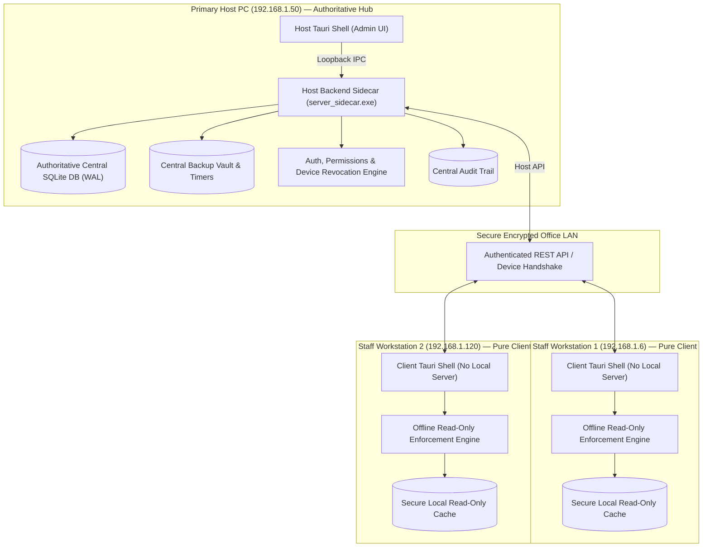

# ARCHITECTURAL DECISION RECORD — ADR-015
## Centralized Host–Client Architecture with Offline Read-Only Mode

**Project:** VS Database 2.0 — Tauri Migration  
**Workspace:** `D:\AntiGravity Automation\VS Database 2.0 - Tauri Migration`  
**Decision Status:** **APPROVED BY PROJECT OWNER**  
**Applies From:** Phase 15 onward  
**Date of Ratification:** 2026-11-03  
**Authors/Auditors:** Principal Release Engineer, Production Reliability Engineer, Security Auditor, Database Reliability Engineer & System Architect  

---

## 1. Context & Business Drivers

In previous phases (Phases 1 through 14C), VS Database 2.0 was developed and validated as a self-contained desktop system with LAN server capabilities. The Tauri 2 shell bundled a Python sidecar (`server_sidecar.exe`) that supervised a local SQLite database (`vs_database_desktop.db`) and optionally served external workstations over LAN.

While this served the initial single-node pilot, office operations require a formalized, robust multi-workstation deployment model. Specifically:
1. **Single Source of Truth:** Having multiple office computers independently running local database servers risks distributed state drift, uncoordinated backups, and dangerous data divergences.
2. **Centralized Authority:** The primary Host PC (`192.168.1.50`) must be the sole custodian of authoritative business records, audit trails, and backups.
3. **Resilience to Network Drops:** If the office LAN or Host PC becomes temporarily unreachable, staff workstations must not crash, hang indefinitely, or lose visibility of previously viewed files.
4. **Data Protection Under Disconnection:** Workstations must never accumulate unsynchronized offline writes or attempt optimistic write-replays that could overwrite newer central records.

---

## 2. Architectural Decision

**VS Database 2.0 shall strictly follow a centralized Host–Client Architecture with an Offline Read-Only Mode.**



### Core Tenets:
1. **Sole Central Authority:** All authoritative business-data reads and writes must pass through the Host API.
2. **Client Non-Server Constraint:** Client applications must never spawn independent database servers or maintain independent business databases.
3. **Pure Read-Only Offline State:** When disconnected from the Host, clients enter an immutable read-only state displaying only previously cached records marked as potentially stale.
4. **No Offline Write Queues:** No offline creation, editing, deletion, or write-replay queues are permitted.

---

## 3. Host System Responsibilities

The designated Host PC (`192.168.1.50`) is the sole authoritative node responsible for:
- **Central Business Database:** Manages `vs_database_desktop.db` with SQLite WAL mode, foreign key enforcement, and ACID transactions.
- **Authoritative API Service:** Hosts the Python backend sidecar listening on physical interface `0.0.0.0:8768`.
- **Identity & Session Authority:** Issues cryptographic session tokens, validates device identities, and manages role-based access control (RBAC).
- **Device Pairing & Instant Revocation:** Authorizes new client workstations via pairing PINs; instantly rejects revoked devices at the API gateway.
- **Centralized Audit Trails:** Records all data creation, modification, deletion, and auth events in `activity_log` and `ai_audit_log`.
- **Centralized Document Storage:** Enforces retention, naming, and staging policies across client folders.
- **Automated Backup & Disaster Recovery:** Executes scheduled automated backups and provides the single point of recovery.

---

## 4. Client System Responsibilities

Each office workstation (e.g., `192.168.1.6`, `192.168.1.120`) operates as an authoritative client:
- **Dedicated Tauri Installation:** Runs its own native Tauri 2 desktop shell providing the glassmorphic desktop interface and native window controls.
- **No Local Backend Daemon:** Client installations do not spawn `server_sidecar.exe` or maintain local SQLite business databases.
- **Configurable Host Resolution:** Resolves and connects to the Host API address (e.g., `http://192.168.1.50:8768`).
- **Secure Device Credentials:** Stores unique client device UUID (`X-VS-Device-Id`) and paired session tokens in encrypted local storage.
- **Heartbeat & Connectivity Monitoring:** Actively monitors host reachability via `/api/desktop/health` heartbeats.
- **Controlled Local Cache:** Securely caches previously fetched client profiles, document metadata, and tax checklists for offline viewing.

---

## 5. Offline Read-Only Mode Specification

When network connectivity to the Host PC is interrupted or the central server is closed:

```
[Host Unreachable Detected]
       │
       ▼
┌────────────────────────────────────────────────────────┐
│ 1. Activate Visual Stale Banner:                       │
│    "Central Server Disconnected — Offline Read-Only"  │
└────────────────────────────────────────────────────────┘
       │
       ▼
┌────────────────────────────────────────────────────────┐
│ 2. Disable All Mutation Actions:                       │
│    - New Client (+ Add Client) -> Disabled / Hidden   │
│    - Edit Client Form -> Fields set to Read-Only      │
│    - Delete Operations -> Disabled                     │
│    - Document Upload / Staging -> Disabled             │
│    - AI Job Submission -> Disabled                     │
└────────────────────────────────────────────────────────┘
       │
       ▼
┌────────────────────────────────────────────────────────┐
│ 3. Serve From Secure Local Cache:                      │
│    - Render previously fetched clients with badge      │
│      "Cached Data — Stale as of [Timestamp]"           │
└────────────────────────────────────────────────────────┘
       │
       ▼
┌────────────────────────────────────────────────────────┐
│ 4. Strictly Prohibit Write Queuing:                    │
│    - No localStorage mutation queue                    │
│    - No automatic write replay on reconnect            │
└────────────────────────────────────────────────────────┘
```

### Safety Protections:
- **Host-Side Enforcement:** Even if a rogue client attempts to send mutation requests, the Host API independently validates authorization, timestamps, and active session tokens.
- **Zero Reconciliation Conflicts:** Because offline writes are strictly blocked, merge conflicts, split-brain scenarios, and duplicate client records are structurally impossible.

---

## 6. Reconnection & Session Revalidation Protocol

When LAN connectivity to the Host PC is restored:
1. **Connectivity Detection:** The client heartbeat probe detects HTTP 200 from `/api/desktop/health`.
2. **Device Revalidation:** Client transmits `X-VS-Device-Id` and active session token to `/api/auth/validate-session`.
3. **Revocation Check:** If the host administrator revoked the device while offline, the host returns HTTP 403. The client purges local cache and transitions to a locked pairing screen.
4. **Session Re-establishment:** If valid, the host returns current permissions and active user profile.
5. **Cache Invalidation & Fresh Fetch:** The client discards stale cache and fetches fresh authoritative records from the Host API.
6. **Online UI Restoration:** The disconnected banner clears; write actions are re-enabled according to verified user permissions.

---

## 7. Requirement-to-Code Mapping & Gap Analysis

An exhaustive inspection of the existing VS Database 2.0 codebase was conducted to determine what is currently implemented versus what constitutes an implementation gap for Phase 15:

| ADR-015 Requirement | Existing Source Code File | Current Implementation Status | Gap Description / Required Phase 15 Work |
| :--- | :--- | :--- | :--- |
| **Central Host API Binding** | `server.py` (lines 203–214) | **PARTIALLY IMPLEMENTED** | Backend binds to `0.0.0.0:8768` and handles multi-PC requests. Gap: Host-side role configuration flag (`--host-mode`) needed. |
| **Client Host Address Configuration** | `static/tauri-bridge.js` (lines 27–37) | **MISSING (GAP-001)** | `getBaseUrl()` hardcodes `http://127.0.0.1:8767`. Needs configurable Host IP resolution (`vs-host-url` in client config). |
| **Client Launcher Mode** | `src-tauri/src/lib.rs` (lines 252–285) | **MISSING (GAP-002)** | Rust supervisor always spawns local `server_sidecar.exe`. Needs a pure "Client Mode" flag that skips local sidecar spawning and connects directly to Host IP. |
| **Host Device Pairing & Revocation**| `server.py` (`/api/devices`, `/api/auth`) | **PARTIALLY IMPLEMENTED** | `devices` table and pairing logic exist. Gap: Instant revocation push/poll mechanism and explicit client pairing UI. |
| **Client Offline Connectivity Monitor**| `static/app.js` (`api()`, lines 280–319)| **MISSING (GAP-003)** | `api()` fails with uncaught fetch error. Needs central connectivity state machine (`online`, `offline`, `reconnecting`). |
| **Offline Read-Only UI Enforcement** | `static/app.js` (DOM event handlers) | **MISSING (GAP-004)** | Mutation buttons remain enabled when offline. Needs global UI state controller that disables mutation buttons and sets forms to read-only. |
| **Controlled Local Read-Only Cache** | `static/app.js` (data layer) | **MISSING (GAP-005)** | No local caching of client search results or records. Needs encrypted/scoped `sessionStorage` or `IndexedDB` read-only cache with staleness tags. |
| **Host-Side Write Guard** | `server.py` (Route decorators) | **PARTIALLY IMPLEMENTED** | Token check exists. Gap: Explicit write-operation permission enforcement distinguishing read-only clients from full operators. |
| **Audit Logging on Host** | `server.py` (`log_activity`, `ai_audit_log`) | **IMPLEMENTED** | Central audit logging active in SQLite tables. Meets requirement. |
| **Central Backup Automation** | `server.py` (`backup_timer_thread`) | **IMPLEMENTED** | 60-minute automated backup timer active on host. Restorability verified in Phase 14B. |

---

## 8. Phase 15 Implementation Gates

Before Phase 15 can be certified production-ready, the following ten technical gates must be independently verified by the Gravitas verification runtime:

- [ ] **Gate 1: Host Mode Configuration:** Central Host backend initialized with explicit `--host-mode` on `192.168.1.50:8768`.
- [ ] **Gate 2: Pure Client Tauri Bundle:** Client Tauri executable configured to launch without spawning local Python sidecar, resolving Host IP dynamically.
- [ ] **Gate 3: Device Pairing Handshake:** Client workstation securely pairs with Host using one-time PIN and stores device credentials.
- [ ] **Gate 4: Host-Side Authorization:** Host API rejects unauthenticated, revoked, or expired requests on every write route.
- [ ] **Gate 5: Offline State Detection:** Client UI immediately detects host disconnection within 2 heartbeat cycles (< 5 seconds).
- [ ] **Gate 6: Offline Read-Only Lockdown:** Disconnected client UI disables all creation, editing, deletion, and upload controls.
- [ ] **Gate 7: Stale Cache Presentation:** Disconnected client serves previously fetched records with a clear "Potentially Stale" banner.
- [ ] **Gate 8: Reconnection & Revalidation:** Reconnected client re-validates device identity, purges stale cache, and re-enables online mode without write-replay.
- [ ] **Gate 9: Concurrent Multi-Client Writes:** Host handles concurrent write requests from multiple clients with zero SQLite locks (`SQLITE_BUSY` = 0).
- [ ] **Gate 10: Fail-Safe Rollback:** Instantaneous process-switch rollback back to `VS Desktop App\VS_Database.exe` remains verified (< 35 seconds RTO).

---

## 9. Unresolved Risks & Constraints

1. **Physical Office Deployment Constraint:**  
   Client mode cannot be verified solely over loopback. True multi-PC LAN testing requires physical execution on Workstation 1 (`192.168.1.6`) and Workstation 2 (`192.168.1.120`).
2. **Network Address Stability:**  
   The Host PC must maintain a static or reserved DHCP IP address (`192.168.1.50`). A dynamic IP change would sever client connectivity.
3. **Database Migration Boundary:**  
   The 2,533 post-branch legacy records documented in [`PHASE_14C_DATABASE_RECONCILIATION_DECISION.md`](file:///D:/AntiGravity%20Automation/VS%20Database%202.0%20-%20Tauri%20Migration/PHASE_14C_DATABASE_RECONCILIATION_DECISION.md) must be migrated to the Host DB using Option A before client workstations go live.

---

## 10. Architectural Governance Verdict

```
========================================================================================
ADR-015 ARCHITECTURAL RATIFICATION VERDICT:
DECISION: APPROVED & INCORPORATED INTO SYSTEM BLUEPRINT
========================================================================================
- Architectural Model: Centralized Host–Client with Offline Read-Only Mode
- Applicable Phases: Phase 15 and all future development
- Primary Authority: Host PC (192.168.1.50)
- Client Constraint: Pure client application; zero independent database servers
- Offline Mode: Read-only access to cached records; zero offline write queuing
- Implementation Status: 5 Core Gaps identified; mapped to Phase 15 implementation gates
========================================================================================
```
