# VS Database 2.0 — SQLite Database Audit & Technical Specification

**Database Target:** `D:\AntiGravity Automation\VS Database 2.0 - Tauri Migration\data\vs_database_desktop.db`  
**Audit Date:** November 2, 2026  
**Auditor:** SQL Database Engineer (Tauri 2.0 Migration Team)  
**Target Environment:** Tauri 2.0 (Rust Core + SQLite) + Python 3.14 Background Automation Services  

---

## 1. Executive Summary

A comprehensive structural, operational, and concurrency audit was executed on the copied primary desktop database `vs_database_desktop.db` for the **VS Database 2.0 Tauri Migration**.

The audit verified **43 SQLite tables** (42 application tables + 1 SQLite internal metadata table `sqlite_sequence`), containing a cumulative total of **13,118 records** across **35.03 MB** of disk storage (8,552 pages at 4,096 bytes/page).

### Key Audit Findings:
- **Physical Integrity**: `PRAGMA integrity_check` returned **`ok`**. No b-tree structural corruption, page allocation mismatches, or file damage detected.
- **Journal Mode**: The database is running in **Write-Ahead Logging (`WAL`)** mode, which is optimal for concurrent multi-process access between Tauri (Rust) and background Python worker daemons.
- **Foreign Key Enforcement Gap**: `PRAGMA foreign_keys` is set to **`0` (disabled)** by default. Executing `PRAGMA foreign_key_check` identified **22 orphaned child records** (15 in `ai_memory_history`, 7 in `ai_messages`) that reference non-existent parent rows due to unconstrained cascade deletions in prior versions.
- **Schema Versioning**: `PRAGMA user_version` is currently `0`. Migrations were historically applied ad-hoc via Python `try/except ALTER TABLE` blocks rather than a deterministic schema migration ledger.
- **Test Database Isolation Risk**: Several test suites previously attached directly to `data/vs_database_desktop.db`. A strict **SQLite Online Backup Replication Harness** has been verified to eliminate this hazard.

### Database Overview Matrix

| Metric | Value | Technical Context |
| :--- | :--- | :--- |
| **Database File** | `vs_database_desktop.db` | Primary copied database |
| **File Size** | 35,028,992 bytes (~33.4 MB) | 8,552 pages (4 KB page size) |
| **Total Tables** | **43 tables** | 42 user tables + `sqlite_sequence` |
| **Total Records** | **13,118 rows** | High-volume: transactions (4,878), chunks (2,506), facts (1,751) |
| **Total Custom Indexes** | 26 explicit indexes | Plus 30 primary/unique autoindexes |
| **Triggers** | 0 triggers | Business logic handled in application layer |
| **Views** | 0 views | Schema relies on direct table queries |
| **Integrity Check** | **`ok`** | Verified via `PRAGMA integrity_check` |
| **Foreign Key Check** | **22 violations detected** | Orphaned records in `ai_memory_history` & `ai_messages` |
| **Journal Mode** | `WAL` | Write-Ahead Logging active |
| **Synchronous** | `2` (`FULL`) | Recommend `1` (`NORMAL`) for WAL mode |
| **Busy Timeout** | 5,000 ms (db default) / 30,000 ms (server) | Recommend 30,000 ms globally |
| **User Version** | `0` | Requires migration state machine |

---

## 2. SQLite PRAGMA Configuration & Concurrency Analysis


The database operates under concurrent access by:
1. **Tauri 2.0 Desktop Application** (Rust backend handling UI, client browsing, session authorization).
2. **Background Python Automation Workers** (Bank statement parsing, Tally XML posting, document classification, AI embeddings).

### PRAGMA Audit Findings

```sql
PRAGMA journal_mode;        -- wal
PRAGMA synchronous;         -- 2 (FULL)
PRAGMA foreign_keys;        -- 0 (OFF)
PRAGMA busy_timeout;        -- 5000 (ms)
PRAGMA page_size;           -- 4096 (bytes)
PRAGMA page_count;          -- 8552
PRAGMA cache_size;          -- -2000 (approx 2 MB)
PRAGMA wal_autocheckpoint;  -- 1000 (pages)
PRAGMA user_version;        -- 0
PRAGMA application_id;      -- 0
PRAGMA encoding;            -- "UTF-8"
```

### Concurrency Optimization Recommendations for Tauri 2.0:
1. **Adopt `PRAGMA synchronous = NORMAL;`**:
   - In WAL mode, `NORMAL` synchronous guarantees 100% ACID integrity against application crashes and operating system crashes (only non-recoverable power failure of the host prior to disk cache flush poses risk, and even then SQLite rolls back to the last valid transaction).
   - `NORMAL` reduces disk I/O synchronization overhead by over 70% compared to `FULL` synchronous.
2. **Standardize `PRAGMA busy_timeout = 30000;`**:
   - Ensure both Tauri's database pool (e.g. `r2d2-sqlite` or `sqlx`) and Python worker connections set a 30-second busy timeout immediately upon connection initialization. This eliminates `sqlite3.OperationalError: database is locked` during concurrent high-throughput operations (such as bank transaction ingestion while the UI searches clients).
3. **Connection Pooling Strategy**:
   - **Tauri / Rust Core**: Maintain a single write connection (or dedicated serialized write thread) with a pool of read-only connections (`?mode=ro`). SQLite WAL allows unlimited concurrent readers while a single writer operates.
   - **Python Workers**: For long-running batch jobs (e.g. statement parsing), use chunked transactions (`BEGIN IMMEDIATE ... COMMIT` in batches of 250-500 transactions) rather than holding open-ended write locks.
4. **WAL Checkpointing Management**:
   - Implement a passive checkpoint hook `PRAGMA wal_checkpoint(PASSIVE)` or scheduled `PRAGMA wal_checkpoint(TRUNCATE)` during idle periods to prevent `vs_database_desktop.db-wal` from growing indefinitely.


---

## 3. Entity-Relationship & Domain Architecture

The 43 tables are divided into five distinct functional domains. The diagram below illustrates the core relational links and cross-table references:

```mermaid
erDiagram
    clients ||--o{ client_folder_mappings : "maps"
    clients ||--o{ folder_inventory : "contains"
    clients ||--o{ file_inventory : "stores"
    clients ||--o{ client_pdf_credentials : "authenticates"
    clients ||--o{ client_portals : "shares"
    clients ||--o{ portal_blocks : "revokes"
    clients ||--o{ client_folder_overrides : "customizes"
    clients ||--o{ save_jobs : "records"
    clients ||--o{ ai_conversations : "associates"

    users ||--o{ devices : "registers"
    users ||--o{ sessions : "authenticates"
    devices ||--o{ sessions : "binds"
    users ||--o{ access_requests : "requests"
    users ||--o{ extension_exchange_codes : "authorizes"

    ai_sources ||--o{ ai_source_versions : "versions"
    ai_sources ||--o{ ai_source_chunks : "segments"
    ai_conversations ||--o{ ai_messages : "contains"
    ai_conversations ||--o{ ai_conversation_facts : "extracts"
    ai_conversations ||--o{ ai_clarification_sessions : "clarifies"
    ai_conversations ||--o{ ai_artifacts : "generates"
    ai_memory ||--o{ ai_memory_history : "tracks"

    automation_import_sessions ||--o{ automation_transactions : "contains"
    automation_import_sessions ||--o{ automation_posting_records : "audits"
    automation_ask_tally_sessions ||--o{ automation_ask_tally_messages : "chats"
```




---

## 4. Module-by-Module Table Catalog & Data Volume


### Core Client & Firm Management

| Table Name | Row Count | Columns | Primary Key | Explicit FKs | Explicit Indexes | Description |
| :--- | :---: | :---: | :--- | :--- | :--- | :--- |
| `clients` | 5 | 9 | `file_no` | None | idx_clients_type, idx_clients_name | Primary master record of CA/tax clients |
| `firm_types` | 4 | 6 | `id` | None | None | Client entity classification (Individual, LLP, etc.) |
| `category_templates` | 6 | 4 | `category` | None | None | Hierarchical folder blueprint templates by category |
| `folder_rules` | 1 | 4 | `id` | None | None | Service and period folder sorting rules |
| `client_folder_mappings` | 8 | 4 | `client_file_no, storage_kind` | None | None | Mapping client folders across local & Google Drive |
| `client_folder_overrides` | 1 | 3 | `client_file_no` | 1 FK | None | Per-client customized directory folder tree JSON |
| `folder_inventory` | 94 | 6 | `client_file_no, storage_kind, relative_path` | None | None | Physical/cloud directory scan inventory |
| `file_inventory` | 254 | 7 | `client_file_no, storage_kind, relative_path` | None | None | Scanned document inventory with sizes and timestamps |
| `client_pdf_credentials` | 0 | 7 | `id` | 1 FK | idx_pdf_cred_client | AES-encrypted passwords for client tax/bank PDFs |
| `client_portals` | 5 | 5 | `client_file_no` | None | idx_portals_client | External portal links and Drive folder identifiers |
| `portal_blocks` | 0 | 6 | `client_file_no` | None | None | Access revocation logs for compromised portals |

### Operations & System Settings

| Table Name | Row Count | Columns | Primary Key | Explicit FKs | Explicit Indexes | Description |
| :--- | :---: | :---: | :--- | :--- | :--- | :--- |
| `settings` | 23 | 2 | `key` | None | None | Key-value persistent application configuration |
| `save_jobs` | 190 | 16 | `id` | None | None | Document dispatch and archiving queue jobs |
| `activity_log` | 205 | 12 | `id` | None | idx_activity_created, idx_activity_id | System operational audit trail with rollback metadata |
| `security_alerts` | 0 | 11 | `id` | None | None | Security events and privilege escalation alerts |
| `sqlite_sequence` | 4 | 2 | `ROWID` | None | None | SQLite system table tracking autoincrement counters |

### Authentication & Security Management

| Table Name | Row Count | Columns | Primary Key | Explicit FKs | Explicit Indexes | Description |
| :--- | :---: | :---: | :--- | :--- | :--- | :--- |
| `users` | 1 | 8 | `user_id` | None | None | Host and staff authentication credentials and roles |
| `devices` | 1 | 9 | `device_id` | 1 FK | None | Registered client machines and hardware fingerprints |
| `access_requests` | 0 | 8 | `request_id` | None | None | Pending network pairing requests from staff machines |
| `sessions` | 89 | 9 | `session_id` | 2 FK | None | Active session tokens and authentication states |
| `extension_exchange_codes` | 0 | 6 | `code` | None | None | Short-lived pairing tokens for browser extension |

### AI Assistant & Statutory Knowledge Base

| Table Name | Row Count | Columns | Primary Key | Explicit FKs | Explicit Indexes | Description |
| :--- | :---: | :---: | :--- | :--- | :--- | :--- |
| `ai_conversations` | 77 | 10 | `id` | None | None | AI chat sessions with clients or general topics |
| `ai_messages` | 296 | 6 | `id` | 1 FK | idx_ai_msg_conv | User prompts, LLM responses, and statutory citations |
| `ai_attachments` | 0 | 8 | `id` | None | None | Uploaded reference documents for AI analysis |
| `ai_sources` | 50 | 15 | `source_id` | None | None | Statutory legal texts, Acts, and circulars |
| `ai_source_versions` | 50 | 9 | `version_id` | 1 FK | None | PDF versions and SHA-256 integrity hashes for statutes |
| `ai_source_chunks` | 2,506 | 9 | `chunk_id` | 1 FK | idx_ai_chunks_src | Text chunks and section headings for vector/RAG search |
| `ai_recent_operations` | 6 | 6 | `id` | None | idx_ai_rec_ops | Log of recent AI operations for fast dashboard access |
| `ai_model_registry` | 5 | 21 | `model_id` | None | None | Local Ollama models and cloud LLM runtime configs |
| `ai_memory` | 6 | 11 | `memory_id` | None | idx_ai_mem_key, idx_ai_mem_client, idx_ai_mem_scope | Explicit & learned firm facts and user preferences |
| `ai_memory_history` | 25 | 8 | `history_id` | 1 FK | idx_ai_mem_hist | Audit log of memory updates, deletions, and additions |
| `ai_artifacts` | 510 | 16 | `artifact_id` | None | idx_ai_artifacts_client, idx_ai_artifacts_conv | Generated legal documents, audit notes, Excel workbooks |
| `ai_conversation_facts` | 1,751 | 10 | `id` | None | idx_ai_conv_facts_key, idx_ai_conv_facts_cid | Extracted semantic key-value facts per conversation |
| `ai_clarification_sessions` | 176 | 12 | `session_id` | None | idx_ai_clarif_status, idx_ai_clarif_cid | Multi-turn question sessions for ambiguous prompts |
| `ai_jobs` | 41 | 9 | `job_id` | None | None | Background queue for batch AI jobs (indexing, drafting) |
| `ai_audit_log` | 46 | 5 | `id` | None | None | Security and compliance audit trail for AI operations |

### Bank Automation & Tally Integration

| Table Name | Row Count | Columns | Primary Key | Explicit FKs | Explicit Indexes | Description |
| :--- | :---: | :---: | :--- | :--- | :--- | :--- |
| `automation_import_sessions` | 24 | 25 | `session_id` | None | None | Bank statement file imports, reconciliation states |
| `automation_transactions` | 4,878 | 34 | `transaction_id` | 1 FK | idx_auto_txns_date, idx_auto_txns_narr, idx_auto_txns_sess | Extracted bank transactions, AI mappings, Tally refs |
| `automation_mapping_rules` | 46 | 14 | `rule_id` | None | idx_auto_rules_comp | Company-specific regex/narration-to-ledger rules |
| `automation_posting_records` | 1,341 | 13 | `record_id` | 1 FK | idx_auto_post_sess | Historical audit of XML payloads posted to Tally ERP |
| `automation_ask_tally_sessions` | 5 | 5 | `session_id` | None | None | Natural language query sessions on accounting ledgers |
| `automation_ask_tally_messages` | 8 | 7 | `message_id` | 1 FK | idx_auto_ask_sess | Chat messages and tool invocations for Ask Tally |
| `automation_company_learning` | 380 | 11 | `learning_id` | None | idx_auto_learn_comp | Dynamic machine learning patterns for bank narration |

---

## 5. Foreign Key Integrity Audit & Violation Analysis

### Integrity Check Results
- `PRAGMA integrity_check;` returned **`ok`**.
- The physical database pages, b-tree structures, and indexes are 100% healthy.

### Foreign Key Check Results (`PRAGMA foreign_key_check`)
SQLite returned **22 foreign key constraint violations** distributed across two tables:
1. **`ai_memory_history` (15 violations)**:
   - Rows `11` through `25` reference `memory_id = 'mem_usr_e833563975'`, which does not exist in `ai_memory`.
   - **Root Cause**: The parent memory record was deleted while `PRAGMA foreign_keys = OFF`. Because SQLite does not enforce `ON DELETE CASCADE` unless foreign keys are explicitly turned on per connection, the parent row was removed while child history rows remained.
2. **`ai_messages` (7 violations)**:
   - Rows `23`, `24`, `25` reference `conversation_id = 'conv_672a0d2adb'`, which does not exist in `ai_conversations`.
   - Rows `169`, `170` reference `conversation_id = 'conv_test_auto_title_123'`, which does not exist in `ai_conversations`.
   - Rows `171`, `172` reference `conversation_id = 'conv_test_auto_title_456'`, which does not exist in `ai_conversations`.
   - **Root Cause**: Test conversations were deleted from `ai_conversations` during automated testing or user cleanup without removing associated messages because foreign key cascading was disabled.

### Remediation Script for Pre-Migration Cleanup
To safely enable `PRAGMA foreign_keys = ON;` in Tauri 2.0 without encountering constraint exceptions, execute the following non-destructive repair transaction:

```sql
-- Safe Foreign Key Violation Remediation Script
BEGIN TRANSACTION;

-- 1. Remove orphaned AI memory history entries
DELETE FROM ai_memory_history 
WHERE memory_id NOT IN (SELECT memory_id FROM ai_memory);

-- 2. Remove orphaned AI messages referencing purged test conversations
DELETE FROM ai_messages 
WHERE conversation_id NOT IN (SELECT id FROM ai_conversations);

-- 3. Verify zero violations remain
PRAGMA foreign_key_check;

COMMIT;
```


---

## 6. Index Catalog & Performance Optimization Analysis

The database contains **26 custom indexes** designed for fast search and relational joining:

### Existing Indexes Catalog
| Table | Index Name | Columns | Target Operations |
| :--- | :--- | :--- | :--- |
| `activity_log` | `idx_activity_id` | `id` | ID-based log retrieval |
| `activity_log` | `idx_activity_created` | `created_at` | Chronological activity feed |
| `ai_artifacts` | `idx_ai_artifacts_client` | `client_file_no` | Client document filtering |
| `ai_artifacts` | `idx_ai_artifacts_conv` | `conversation_id` | Conversation artifact listing |
| `ai_clarification_sessions` | `idx_ai_clarif_cid` | `conversation_id` | Clarification lookups |
| `ai_clarification_sessions` | `idx_ai_clarif_status` | `status` | Active clarification queue |
| `ai_conversation_facts` | `idx_ai_conv_facts_cid` | `conversation_id` | Contextual fact injection |
| `ai_conversation_facts` | `idx_ai_conv_facts_key` | `fact_key` | Fact key retrieval |
| `ai_memory` | `idx_ai_mem_client` | `client_file_no, status` | Client-scoped memory lookups |
| `ai_memory` | `idx_ai_mem_key` | `key` | Exact memory key indexing |
| `ai_memory` | `idx_ai_mem_scope` | `scope, status` | Global/User scope filtering |
| `ai_memory_history` | `idx_ai_mem_hist` | `memory_id` | Memory change audit history |
| `ai_messages` | `idx_ai_msg_conv` | `conversation_id` | Thread message rendering |
| `ai_recent_operations` | `idx_ai_rec_ops` | `created_at` | Recent actions panel |
| `ai_source_chunks` | `idx_ai_chunks_src` | `source_id` | Source chunk retrieval |
| `automation_ask_tally_messages` | `idx_auto_ask_sess` | `session_id` | Chat history retrieval |
| `automation_company_learning` | `idx_auto_learn_comp` | `company_name, normalized_pattern, direction_condition` | Narration pattern matching |
| `automation_mapping_rules` | `idx_auto_rules_comp` | `company_name, is_active` | Company rule filtering |
| `automation_posting_records` | `idx_auto_post_sess` | `session_id` | Session posting history |
| `automation_transactions` | `idx_auto_txns_date` | `txn_date` | Date range filtering |
| `automation_transactions` | `idx_auto_txns_narr` | `normalized_narration` | Narration-based grouping |
| `automation_transactions` | `idx_auto_txns_sess` | `session_id` | Import session transactions |
| `client_pdf_credentials` | `idx_pdf_cred_client` | `client_file_no` | Credential lookups |
| `client_portals` | `idx_portals_client` | `client_file_no` | Portal folder resolution |
| `clients` | `idx_clients_name` | `name` | Client search by name |
| `clients` | `idx_clients_type` | `client_type` | Client filtering by firm type |

### Recommended Additional Indexes for Tauri 2.0
The audit identified several high-frequency query paths lacking composite indexes:

```sql
-- 1. Accelerates bank transaction posting status filtering (4,878 rows)
CREATE INDEX IF NOT EXISTS idx_auto_txns_posting 
ON automation_transactions(session_id, posting_status);

-- 2. Accelerates duplicate transaction detection during statement imports
CREATE INDEX IF NOT EXISTS idx_auto_txns_duplicate 
ON automation_transactions(session_id, duplicate_status);

-- 3. Accelerates save jobs dashboard queue filtering
CREATE INDEX IF NOT EXISTS idx_save_jobs_status_created 
ON save_jobs(status, created_at DESC);

-- 4. Accelerates file inventory searches by client and storage backend
CREATE INDEX IF NOT EXISTS idx_file_inv_client_storage 
ON file_inventory(client_file_no, storage_kind);
```


---

## 7. Safe Test Database Replication Procedures

### The Problem
During review of the test suite (`test_controlled_correction.py`, `test_vs_ai_3_0.py`, `test_six_enhancements.py`), tests were found opening write connections directly against `data/vs_database_desktop.db`. In the Tauri 2.0 QA pipeline, this poses an extreme risk of data corruption, test contamination, or unintentional mutation of primary records.

### The Verified Solution: SQLite Online Backup Replication
Filesystem copies (`shutil.copy2`) while a WAL database is active can copy inconsistent page states if the `-wal` file is undergoing a checkpoint. 

The standard, failsafe procedure uses **SQLite's Online Backup API** (`sqlite3.backup()` in Python / `rusqlite::backup` in Rust). This creates a byte-consistent, standalone snapshot of the active database without requiring locks on active readers:

```python
import sqlite3
from pathlib import Path

def create_isolated_test_db(source_db_path: Path, target_db_path: Path) -> Path:
    """
    Creates an isolated test replica of vs_database_desktop.db.
    Guarantees zero mutation to the primary database.
    """
    if target_db_path.exists():
        target_db_path.unlink()
        
    # Open source in STRICT READ-ONLY URI mode
    src_uri = f"file:{source_db_path.resolve().as_posix()}?mode=ro"
    src_conn = sqlite3.connect(src_uri, uri=True)
    dst_conn = sqlite3.connect(target_db_path)
    
    try:
        # Perform atomic page-by-page backup
        src_conn.backup(dst_conn, pages=100)
    finally:
        dst_conn.close()
        src_conn.close()
        
    return target_db_path
```

### Pytest Fixture for QA Automation
```python
import pytest
import tempfile
from pathlib import Path

PRIMARY_DB = Path(r"D:\AntiGravity Automation\VS Database 2.0 - Tauri Migration\data\vs_database_desktop.db")

@pytest.fixture
def isolated_db(monkeypatch):
    with tempfile.TemporaryDirectory() as tmpdir:
        test_db = Path(tmpdir) / "test_vs_database.db"
        create_isolated_test_db(PRIMARY_DB, test_db)
        # Override application DB path in environment and server module
        monkeypatch.setenv("VS_DATABASE_PATH", str(test_db))
        yield test_db
```

### Verification Test Result
A rigorous replication test script was executed:
1. Computed SHA-256 hash of primary database: `901c2e7c679a07f4fcae5a9111a34d76c343469423ea0bc3c6d1f966cfb06812`.
2. Created replica via Online Backup API.
3. Mutated replica heavily (deleted all activity log records, inserted dummy configuration).
4. Recomputed SHA-256 hash of primary database: `901c2e7c679a07f4fcae5a9111a34d76c343469423ea0bc3c6d1f966cfb06812`.
5. **Result: Hash match 100%. Primary database verified unmutated.**


---

## 8. Complete Schema DDL for All 43 Tables

Below is the complete, unabridged schema definition (DDL), column layout, constraints, and indexes for all 43 tables in the database.


### 8.1 Table: `access_requests`
- **Type:** TABLE
- **Row Count:** 0
- **Column Count:** 8

**Columns:**
| # | Name | Type | Not Null | Default Value | Primary Key |
| :-: | :--- | :--- | :-: | :--- | :-: |
| 0 | `request_id` | `TEXT` |  | *None* | PK (1) |
| 1 | `user_id` | `TEXT` | ✓ | *None* |  |
| 2 | `device_id` | `TEXT` | ✓ | *None* |  |
| 3 | `device_name` | `TEXT` | ✓ | *None* |  |
| 4 | `ip_address` | `TEXT` | ✓ | *None* |  |
| 5 | `status` | `TEXT` | ✓ | *None* |  |
| 6 | `created_at` | `TEXT` | ✓ | *None* |  |
| 7 | `updated_at` | `TEXT` | ✓ | *None* |  |

**Indexes:**
- `sqlite_autoindex_access_requests_1`: UNIQUE (request_id) [Origin: pk]

**Schema DDL:**
```sql
CREATE TABLE access_requests (
            request_id TEXT PRIMARY KEY,
            user_id TEXT NOT NULL,
            device_id TEXT NOT NULL,
            device_name TEXT NOT NULL,
            ip_address TEXT NOT NULL,
            status TEXT NOT NULL CHECK(status IN ('pending', 'approved', 'rejected')),
            created_at TEXT NOT NULL,
            updated_at TEXT NOT NULL
        )
```


### 8.2 Table: `activity_log`
- **Type:** TABLE
- **Row Count:** 205
- **Column Count:** 12

**Columns:**
| # | Name | Type | Not Null | Default Value | Primary Key |
| :-: | :--- | :--- | :-: | :--- | :-: |
| 0 | `id` | `INTEGER` |  | *None* | PK (1) |
| 1 | `event_type` | `TEXT` | ✓ | *None* |  |
| 2 | `client_file_no` | `TEXT` |  | *None* |  |
| 3 | `client_name` | `TEXT` |  | *None* |  |
| 4 | `details` | `TEXT` |  | *None* |  |
| 5 | `actor` | `TEXT` |  | *None* |  |
| 6 | `created_at` | `TEXT` | ✓ | *None* |  |
| 7 | `target_path` | `TEXT` |  | `''` |  |
| 8 | `source_path` | `TEXT` |  | `''` |  |
| 9 | `storage_kind` | `TEXT` |  | `'local'` |  |
| 10 | `status` | `TEXT` |  | `'completed'` |  |
| 11 | `reverted_at` | `TEXT` |  | *None* |  |

**Indexes:**
- `idx_activity_created`: (created_at) [Origin: c]
- `idx_activity_id`: (id) [Origin: c]

**Schema DDL:**
```sql
CREATE TABLE activity_log (
            id INTEGER PRIMARY KEY AUTOINCREMENT,
            event_type TEXT NOT NULL,
            client_file_no TEXT,
            client_name TEXT,
            details TEXT,
            actor TEXT,
            created_at TEXT NOT NULL
        , target_path TEXT DEFAULT '', source_path TEXT DEFAULT '', storage_kind TEXT DEFAULT 'local', status TEXT DEFAULT 'completed', reverted_at TEXT)
```


### 8.3 Table: `ai_artifacts`
- **Type:** TABLE
- **Row Count:** 510
- **Column Count:** 16

**Columns:**
| # | Name | Type | Not Null | Default Value | Primary Key |
| :-: | :--- | :--- | :-: | :--- | :-: |
| 0 | `artifact_id` | `TEXT` |  | *None* | PK (1) |
| 1 | `user_id` | `TEXT` | ✓ | `'User'` |  |
| 2 | `conversation_id` | `TEXT` |  | *None* |  |
| 3 | `message_id` | `TEXT` |  | *None* |  |
| 4 | `client_file_no` | `TEXT` |  | *None* |  |
| 5 | `artifact_type` | `TEXT` | ✓ | *None* |  |
| 6 | `filename` | `TEXT` | ✓ | *None* |  |
| 7 | `title` | `TEXT` | ✓ | *None* |  |
| 8 | `mime_type` | `TEXT` | ✓ | *None* |  |
| 9 | `storage_path` | `TEXT` | ✓ | *None* |  |
| 10 | `size_bytes` | `INTEGER` | ✓ | `0` |  |
| 11 | `checksum` | `TEXT` |  | *None* |  |
| 12 | `status` | `TEXT` | ✓ | `'ready'` |  |
| 13 | `metadata_json` | `TEXT` |  | `'{}'` |  |
| 14 | `created_at` | `TEXT` | ✓ | *None* |  |
| 15 | `updated_at` | `TEXT` | ✓ | *None* |  |

**Indexes:**
- `idx_ai_artifacts_client`: (client_file_no) [Origin: c]
- `idx_ai_artifacts_conv`: (conversation_id) [Origin: c]
- `sqlite_autoindex_ai_artifacts_1`: UNIQUE (artifact_id) [Origin: pk]

**Schema DDL:**
```sql
CREATE TABLE ai_artifacts (
    artifact_id TEXT PRIMARY KEY,
    user_id TEXT NOT NULL DEFAULT 'User',
    conversation_id TEXT,
    message_id TEXT,
    client_file_no TEXT,
    artifact_type TEXT NOT NULL,
    filename TEXT NOT NULL,
    title TEXT NOT NULL,
    mime_type TEXT NOT NULL,
    storage_path TEXT NOT NULL,
    size_bytes INTEGER NOT NULL DEFAULT 0,
    checksum TEXT,
    status TEXT NOT NULL DEFAULT 'ready',
    metadata_json TEXT DEFAULT '{}',
    created_at TEXT NOT NULL,
    updated_at TEXT NOT NULL
)
```


### 8.4 Table: `ai_attachments`
- **Type:** TABLE
- **Row Count:** 0
- **Column Count:** 8

**Columns:**
| # | Name | Type | Not Null | Default Value | Primary Key |
| :-: | :--- | :--- | :-: | :--- | :-: |
| 0 | `id` | `TEXT` |  | *None* | PK (1) |
| 1 | `message_id` | `TEXT` |  | *None* |  |
| 2 | `conversation_id` | `TEXT` | ✓ | *None* |  |
| 3 | `filename` | `TEXT` | ✓ | *None* |  |
| 4 | `file_type` | `TEXT` | ✓ | *None* |  |
| 5 | `file_path` | `TEXT` | ✓ | *None* |  |
| 6 | `size_bytes` | `INTEGER` | ✓ | `0` |  |
| 7 | `created_at` | `TEXT` | ✓ | *None* |  |

**Indexes:**
- `sqlite_autoindex_ai_attachments_1`: UNIQUE (id) [Origin: pk]

**Schema DDL:**
```sql
CREATE TABLE ai_attachments (
            id TEXT PRIMARY KEY,
            message_id TEXT,
            conversation_id TEXT NOT NULL,
            filename TEXT NOT NULL,
            file_type TEXT NOT NULL,
            file_path TEXT NOT NULL,
            size_bytes INTEGER NOT NULL DEFAULT 0,
            created_at TEXT NOT NULL
        )
```


### 8.5 Table: `ai_audit_log`
- **Type:** TABLE
- **Row Count:** 46
- **Column Count:** 5

**Columns:**
| # | Name | Type | Not Null | Default Value | Primary Key |
| :-: | :--- | :--- | :-: | :--- | :-: |
| 0 | `id` | `INTEGER` |  | *None* | PK (1) |
| 1 | `action` | `TEXT` | ✓ | *None* |  |
| 2 | `user_id` | `TEXT` | ✓ | *None* |  |
| 3 | `details_json` | `TEXT` | ✓ | `'{}'` |  |
| 4 | `created_at` | `TEXT` | ✓ | *None* |  |

**Schema DDL:**
```sql
CREATE TABLE ai_audit_log (
            id INTEGER PRIMARY KEY AUTOINCREMENT,
            action TEXT NOT NULL,
            user_id TEXT NOT NULL,
            details_json TEXT NOT NULL DEFAULT '{}',
            created_at TEXT NOT NULL
        )
```


### 8.6 Table: `ai_clarification_sessions`
- **Type:** TABLE
- **Row Count:** 176
- **Column Count:** 12

**Columns:**
| # | Name | Type | Not Null | Default Value | Primary Key |
| :-: | :--- | :--- | :-: | :--- | :-: |
| 0 | `session_id` | `TEXT` |  | *None* | PK (1) |
| 1 | `conversation_id` | `TEXT` | ✓ | *None* |  |
| 2 | `message_id` | `TEXT` |  | *None* |  |
| 3 | `round_number` | `INTEGER` | ✓ | `1` |  |
| 4 | `status` | `TEXT` | ✓ | `'active'` |  |
| 5 | `domain` | `TEXT` |  | *None* |  |
| 6 | `known_facts_json` | `TEXT` | ✓ | `'{}'` |  |
| 7 | `missing_facts_json` | `TEXT` | ✓ | `'[]'` |  |
| 8 | `questions_json` | `TEXT` | ✓ | `'[]'` |  |
| 9 | `answers_json` | `TEXT` | ✓ | `'{}'` |  |
| 10 | `created_at` | `TEXT` | ✓ | *None* |  |
| 11 | `updated_at` | `TEXT` | ✓ | *None* |  |

**Indexes:**
- `idx_ai_clarif_status`: (status) [Origin: c]
- `idx_ai_clarif_cid`: (conversation_id) [Origin: c]
- `sqlite_autoindex_ai_clarification_sessions_1`: UNIQUE (session_id) [Origin: pk]

**Schema DDL:**
```sql
CREATE TABLE ai_clarification_sessions (
                session_id TEXT PRIMARY KEY,
                conversation_id TEXT NOT NULL,
                message_id TEXT,
                round_number INTEGER NOT NULL DEFAULT 1,
                status TEXT NOT NULL DEFAULT 'active',
                domain TEXT,
                known_facts_json TEXT NOT NULL DEFAULT '{}',
                missing_facts_json TEXT NOT NULL DEFAULT '[]',
                questions_json TEXT NOT NULL DEFAULT '[]',
                answers_json TEXT NOT NULL DEFAULT '{}',
                created_at TEXT NOT NULL,
                updated_at TEXT NOT NULL
            )
```


### 8.7 Table: `ai_conversation_facts`
- **Type:** TABLE
- **Row Count:** 1,751
- **Column Count:** 10

**Columns:**
| # | Name | Type | Not Null | Default Value | Primary Key |
| :-: | :--- | :--- | :-: | :--- | :-: |
| 0 | `id` | `TEXT` |  | *None* | PK (1) |
| 1 | `conversation_id` | `TEXT` | ✓ | *None* |  |
| 2 | `fact_key` | `TEXT` | ✓ | *None* |  |
| 3 | `fact_value` | `TEXT` | ✓ | *None* |  |
| 4 | `fact_type` | `TEXT` | ✓ | `'string'` |  |
| 5 | `source` | `TEXT` | ✓ | `'user_explicit'` |  |
| 6 | `confidence` | `REAL` | ✓ | `1.0` |  |
| 7 | `created_at` | `TEXT` | ✓ | *None* |  |
| 8 | `updated_at` | `TEXT` | ✓ | *None* |  |
| 9 | `raw_text` | `TEXT` |  | *None* |  |

**Indexes:**
- `idx_ai_conv_facts_key`: (fact_key) [Origin: c]
- `idx_ai_conv_facts_cid`: (conversation_id) [Origin: c]
- `sqlite_autoindex_ai_conversation_facts_1`: UNIQUE (id) [Origin: pk]
- `sqlite_autoindex_ai_conversation_facts_2`: UNIQUE (conversation_id, fact_key) [Origin: u]

**Schema DDL:**
```sql
CREATE TABLE ai_conversation_facts (
                id TEXT PRIMARY KEY,
                conversation_id TEXT NOT NULL,
                fact_key TEXT NOT NULL,
                fact_value TEXT NOT NULL,
                fact_type TEXT NOT NULL DEFAULT 'string',
                source TEXT NOT NULL DEFAULT 'user_explicit',
                confidence REAL NOT NULL DEFAULT 1.0,
                created_at TEXT NOT NULL,
                updated_at TEXT NOT NULL, raw_text TEXT,
                UNIQUE(conversation_id, fact_key) ON CONFLICT REPLACE
            )
```


### 8.8 Table: `ai_conversations`
- **Type:** TABLE
- **Row Count:** 77
- **Column Count:** 10

**Columns:**
| # | Name | Type | Not Null | Default Value | Primary Key |
| :-: | :--- | :--- | :-: | :--- | :-: |
| 0 | `id` | `TEXT` |  | *None* | PK (1) |
| 1 | `title` | `TEXT` | ✓ | *None* |  |
| 2 | `user_id` | `TEXT` | ✓ | `'User'` |  |
| 3 | `client_file_no` | `TEXT` |  | *None* |  |
| 4 | `source_scope` | `TEXT` | ✓ | `'All Knowledge'` |  |
| 5 | `source_only` | `INTEGER` | ✓ | `0` |  |
| 6 | `is_archived` | `INTEGER` | ✓ | `0` |  |
| 7 | `created_at` | `TEXT` | ✓ | *None* |  |
| 8 | `updated_at` | `TEXT` | ✓ | *None* |  |
| 9 | `state_json` | `TEXT` |  | `'{}'` |  |

**Indexes:**
- `sqlite_autoindex_ai_conversations_1`: UNIQUE (id) [Origin: pk]

**Schema DDL:**
```sql
CREATE TABLE ai_conversations (
            id TEXT PRIMARY KEY,
            title TEXT NOT NULL,
            user_id TEXT NOT NULL DEFAULT 'User',
            client_file_no TEXT,
            source_scope TEXT NOT NULL DEFAULT 'All Knowledge',
            source_only INTEGER NOT NULL DEFAULT 0,
            is_archived INTEGER NOT NULL DEFAULT 0,
            created_at TEXT NOT NULL,
            updated_at TEXT NOT NULL
        , state_json TEXT DEFAULT '{}')
```


### 8.9 Table: `ai_jobs`
- **Type:** TABLE
- **Row Count:** 41
- **Column Count:** 9

**Columns:**
| # | Name | Type | Not Null | Default Value | Primary Key |
| :-: | :--- | :--- | :-: | :--- | :-: |
| 0 | `job_id` | `TEXT` |  | *None* | PK (1) |
| 1 | `user_id` | `TEXT` | ✓ | `'User'` |  |
| 2 | `operation` | `TEXT` | ✓ | *None* |  |
| 3 | `status` | `TEXT` | ✓ | *None* |  |
| 4 | `priority` | `TEXT` | ✓ | `'Normal'` |  |
| 5 | `progress` | `INTEGER` | ✓ | `0` |  |
| 6 | `error_msg` | `TEXT` |  | *None* |  |
| 7 | `created_at` | `TEXT` | ✓ | *None* |  |
| 8 | `updated_at` | `TEXT` | ✓ | *None* |  |

**Indexes:**
- `sqlite_autoindex_ai_jobs_1`: UNIQUE (job_id) [Origin: pk]

**Schema DDL:**
```sql
CREATE TABLE ai_jobs (
            job_id TEXT PRIMARY KEY,
            user_id TEXT NOT NULL DEFAULT 'User',
            operation TEXT NOT NULL,
            status TEXT NOT NULL CHECK(status IN ('Queued', 'Running', 'Completed', 'Failed', 'Cancelled')),
            priority TEXT NOT NULL DEFAULT 'Normal',
            progress INTEGER NOT NULL DEFAULT 0,
            error_msg TEXT,
            created_at TEXT NOT NULL,
            updated_at TEXT NOT NULL
        )
```


### 8.10 Table: `ai_memory`
- **Type:** TABLE
- **Row Count:** 6
- **Column Count:** 11

**Columns:**
| # | Name | Type | Not Null | Default Value | Primary Key |
| :-: | :--- | :--- | :-: | :--- | :-: |
| 0 | `memory_id` | `TEXT` |  | *None* | PK (1) |
| 1 | `scope` | `TEXT` | ✓ | *None* |  |
| 2 | `client_file_no` | `TEXT` |  | *None* |  |
| 3 | `category` | `TEXT` | ✓ | `'preference'` |  |
| 4 | `key` | `TEXT` | ✓ | *None* |  |
| 5 | `value` | `TEXT` | ✓ | *None* |  |
| 6 | `source` | `TEXT` | ✓ | `'user_explicit'` |  |
| 7 | `confidence` | `REAL` | ✓ | `1.0` |  |
| 8 | `status` | `TEXT` | ✓ | `'active'` |  |
| 9 | `created_at` | `TEXT` | ✓ | *None* |  |
| 10 | `updated_at` | `TEXT` | ✓ | *None* |  |

**Indexes:**
- `idx_ai_mem_key`: (key) [Origin: c]
- `idx_ai_mem_client`: (client_file_no, status) [Origin: c]
- `idx_ai_mem_scope`: (scope, status) [Origin: c]
- `sqlite_autoindex_ai_memory_1`: UNIQUE (memory_id) [Origin: pk]

**Schema DDL:**
```sql
CREATE TABLE ai_memory (
            memory_id TEXT PRIMARY KEY,
            scope TEXT NOT NULL CHECK(scope IN ('Global', 'User', 'Staff', 'Client', 'Conversation')),
            client_file_no TEXT,
            category TEXT NOT NULL DEFAULT 'preference',
            key TEXT NOT NULL,
            value TEXT NOT NULL,
            source TEXT NOT NULL DEFAULT 'user_explicit',
            confidence REAL NOT NULL DEFAULT 1.0,
            status TEXT NOT NULL DEFAULT 'active' CHECK(status IN ('active', 'archived', 'deleted')),
            created_at TEXT NOT NULL,
            updated_at TEXT NOT NULL
        )
```


### 8.11 Table: `ai_memory_history`
- **Type:** TABLE
- **Row Count:** 25
- **Column Count:** 8

**Columns:**
| # | Name | Type | Not Null | Default Value | Primary Key |
| :-: | :--- | :--- | :-: | :--- | :-: |
| 0 | `history_id` | `INTEGER` |  | *None* | PK (1) |
| 1 | `memory_id` | `TEXT` | ✓ | *None* |  |
| 2 | `action` | `TEXT` | ✓ | *None* |  |
| 3 | `old_value` | `TEXT` |  | *None* |  |
| 4 | `new_value` | `TEXT` |  | *None* |  |
| 5 | `modified_by` | `TEXT` | ✓ | `'User'` |  |
| 6 | `reason` | `TEXT` |  | *None* |  |
| 7 | `timestamp` | `TEXT` | ✓ | *None* |  |

**Foreign Keys:**
- `memory_id` → `ai_memory(memory_id)` (ON UPDATE NO ACTION, ON DELETE CASCADE)

**Indexes:**
- `idx_ai_mem_hist`: (memory_id) [Origin: c]

**Schema DDL:**
```sql
CREATE TABLE ai_memory_history (
            history_id INTEGER PRIMARY KEY AUTOINCREMENT,
            memory_id TEXT NOT NULL,
            action TEXT NOT NULL CHECK(action IN ('create', 'update', 'archive', 'delete', 'restore')),
            old_value TEXT,
            new_value TEXT,
            modified_by TEXT NOT NULL DEFAULT 'User',
            reason TEXT,
            timestamp TEXT NOT NULL,
            FOREIGN KEY(memory_id) REFERENCES ai_memory(memory_id) ON DELETE CASCADE
        )
```


### 8.12 Table: `ai_messages`
- **Type:** TABLE
- **Row Count:** 296
- **Column Count:** 6

**Columns:**
| # | Name | Type | Not Null | Default Value | Primary Key |
| :-: | :--- | :--- | :-: | :--- | :-: |
| 0 | `id` | `TEXT` |  | *None* | PK (1) |
| 1 | `conversation_id` | `TEXT` | ✓ | *None* |  |
| 2 | `role` | `TEXT` | ✓ | *None* |  |
| 3 | `content` | `TEXT` | ✓ | *None* |  |
| 4 | `meta_json` | `TEXT` | ✓ | `'{}'` |  |
| 5 | `created_at` | `TEXT` | ✓ | *None* |  |

**Foreign Keys:**
- `conversation_id` → `ai_conversations(id)` (ON UPDATE NO ACTION, ON DELETE CASCADE)

**Indexes:**
- `idx_ai_msg_conv`: (conversation_id) [Origin: c]
- `sqlite_autoindex_ai_messages_1`: UNIQUE (id) [Origin: pk]

**Schema DDL:**
```sql
CREATE TABLE ai_messages (
            id TEXT PRIMARY KEY,
            conversation_id TEXT NOT NULL,
            role TEXT NOT NULL CHECK(role IN ('user', 'assistant', 'system')),
            content TEXT NOT NULL,
            meta_json TEXT NOT NULL DEFAULT '{}',
            created_at TEXT NOT NULL,
            FOREIGN KEY(conversation_id) REFERENCES ai_conversations(id) ON DELETE CASCADE
        )
```


### 8.13 Table: `ai_model_registry`
- **Type:** TABLE
- **Row Count:** 5
- **Column Count:** 21

**Columns:**
| # | Name | Type | Not Null | Default Value | Primary Key |
| :-: | :--- | :--- | :-: | :--- | :-: |
| 0 | `model_id` | `TEXT` |  | *None* | PK (1) |
| 1 | `provider` | `TEXT` | ✓ | `'ollama'` |  |
| 2 | `runtime` | `TEXT` | ✓ | `'Ollama'` |  |
| 3 | `model_name` | `TEXT` | ✓ | *None* |  |
| 4 | `version` | `TEXT` |  | *None* |  |
| 5 | `size_gb` | `REAL` | ✓ | `2.0` |  |
| 6 | `quantization` | `TEXT` | ✓ | `'Q4_K_M'` |  |
| 7 | `context_length` | `INTEGER` | ✓ | `8192` |  |
| 8 | `min_vram_mb` | `INTEGER` | ✓ | `0` |  |
| 9 | `recommended_vram_mb` | `INTEGER` | ✓ | `0` |  |
| 10 | `min_ram_gb` | `REAL` | ✓ | `4.0` |  |
| 11 | `cpu_compatible` | `INTEGER` | ✓ | `1` |  |
| 12 | `gpu_compatible` | `INTEGER` | ✓ | `1` |  |
| 13 | `installed` | `INTEGER` | ✓ | `0` |  |
| 14 | `enabled` | `INTEGER` | ✓ | `1` |  |
| 15 | `endpoint` | `TEXT` | ✓ | `'http://127.0.0.1:11434'` |  |
| 16 | `created_at` | `TEXT` | ✓ | *None* |  |
| 17 | `test_status` | `TEXT` |  | `'untested'` |  |
| 18 | `test_results` | `TEXT` |  | `'{}'` |  |
| 19 | `is_active` | `INTEGER` | ✓ | `0` |  |
| 20 | `is_previous` | `INTEGER` | ✓ | `0` |  |

**Indexes:**
- `sqlite_autoindex_ai_model_registry_1`: UNIQUE (model_id) [Origin: pk]

**Schema DDL:**
```sql
CREATE TABLE ai_model_registry (
            model_id TEXT PRIMARY KEY,
            provider TEXT NOT NULL DEFAULT 'ollama',
            runtime TEXT NOT NULL DEFAULT 'Ollama',
            model_name TEXT NOT NULL,
            version TEXT,
            size_gb REAL NOT NULL DEFAULT 2.0,
            quantization TEXT NOT NULL DEFAULT 'Q4_K_M',
            context_length INTEGER NOT NULL DEFAULT 8192,
            min_vram_mb INTEGER NOT NULL DEFAULT 0,
            recommended_vram_mb INTEGER NOT NULL DEFAULT 0,
            min_ram_gb REAL NOT NULL DEFAULT 4.0,
            cpu_compatible INTEGER NOT NULL DEFAULT 1,
            gpu_compatible INTEGER NOT NULL DEFAULT 1,
            installed INTEGER NOT NULL DEFAULT 0,
            enabled INTEGER NOT NULL DEFAULT 1,
            endpoint TEXT NOT NULL DEFAULT 'http://127.0.0.1:11434',
            created_at TEXT NOT NULL
        , test_status TEXT DEFAULT 'untested', test_results TEXT DEFAULT '{}', is_active INTEGER NOT NULL DEFAULT 0, is_previous INTEGER NOT NULL DEFAULT 0)
```


### 8.14 Table: `ai_recent_operations`
- **Type:** TABLE
- **Row Count:** 6
- **Column Count:** 6

**Columns:**
| # | Name | Type | Not Null | Default Value | Primary Key |
| :-: | :--- | :--- | :-: | :--- | :-: |
| 0 | `id` | `TEXT` |  | *None* | PK (1) |
| 1 | `filename` | `TEXT` | ✓ | *None* |  |
| 2 | `file_type` | `TEXT` | ✓ | *None* |  |
| 3 | `operation` | `TEXT` | ✓ | *None* |  |
| 4 | `result_summary` | `TEXT` |  | *None* |  |
| 5 | `created_at` | `TEXT` | ✓ | *None* |  |

**Indexes:**
- `idx_ai_rec_ops`: (created_at) [Origin: c]
- `sqlite_autoindex_ai_recent_operations_1`: UNIQUE (id) [Origin: pk]

**Schema DDL:**
```sql
CREATE TABLE ai_recent_operations (
            id TEXT PRIMARY KEY,
            filename TEXT NOT NULL,
            file_type TEXT NOT NULL,
            operation TEXT NOT NULL,
            result_summary TEXT,
            created_at TEXT NOT NULL
        )
```


### 8.15 Table: `ai_source_chunks`
- **Type:** TABLE
- **Row Count:** 2,506
- **Column Count:** 9

**Columns:**
| # | Name | Type | Not Null | Default Value | Primary Key |
| :-: | :--- | :--- | :-: | :--- | :-: |
| 0 | `chunk_id` | `TEXT` |  | *None* | PK (1) |
| 1 | `source_id` | `TEXT` | ✓ | *None* |  |
| 2 | `version_id` | `TEXT` | ✓ | *None* |  |
| 3 | `page_number` | `INTEGER` | ✓ | `1` |  |
| 4 | `heading` | `TEXT` |  | *None* |  |
| 5 | `content` | `TEXT` | ✓ | *None* |  |
| 6 | `chunk_hash` | `TEXT` | ✓ | *None* |  |
| 7 | `created_at` | `TEXT` | ✓ | *None* |  |
| 8 | `client_file_no` | `TEXT` |  | `NULL` |  |

**Foreign Keys:**
- `source_id` → `ai_sources(source_id)` (ON UPDATE NO ACTION, ON DELETE CASCADE)

**Indexes:**
- `idx_ai_chunks_src`: (source_id) [Origin: c]
- `sqlite_autoindex_ai_source_chunks_1`: UNIQUE (chunk_id) [Origin: pk]

**Schema DDL:**
```sql
CREATE TABLE ai_source_chunks (
            chunk_id TEXT PRIMARY KEY,
            source_id TEXT NOT NULL,
            version_id TEXT NOT NULL,
            page_number INTEGER NOT NULL DEFAULT 1,
            heading TEXT,
            content TEXT NOT NULL,
            chunk_hash TEXT NOT NULL,
            created_at TEXT NOT NULL, client_file_no TEXT DEFAULT NULL,
            FOREIGN KEY(source_id) REFERENCES ai_sources(source_id) ON DELETE CASCADE
        )
```


### 8.16 Table: `ai_source_versions`
- **Type:** TABLE
- **Row Count:** 50
- **Column Count:** 9

**Columns:**
| # | Name | Type | Not Null | Default Value | Primary Key |
| :-: | :--- | :--- | :-: | :--- | :-: |
| 0 | `version_id` | `TEXT` |  | *None* | PK (1) |
| 1 | `source_id` | `TEXT` | ✓ | *None* |  |
| 2 | `version_name` | `TEXT` | ✓ | *None* |  |
| 3 | `effective_from` | `TEXT` |  | *None* |  |
| 4 | `effective_to` | `TEXT` |  | *None* |  |
| 5 | `status` | `TEXT` | ✓ | `'active'` |  |
| 6 | `file_path` | `TEXT` |  | *None* |  |
| 7 | `file_hash` | `TEXT` |  | *None* |  |
| 8 | `created_at` | `TEXT` | ✓ | *None* |  |

**Foreign Keys:**
- `source_id` → `ai_sources(source_id)` (ON UPDATE NO ACTION, ON DELETE CASCADE)

**Indexes:**
- `sqlite_autoindex_ai_source_versions_1`: UNIQUE (version_id) [Origin: pk]

**Schema DDL:**
```sql
CREATE TABLE ai_source_versions (
            version_id TEXT PRIMARY KEY,
            source_id TEXT NOT NULL,
            version_name TEXT NOT NULL,
            effective_from TEXT,
            effective_to TEXT,
            status TEXT NOT NULL DEFAULT 'active',
            file_path TEXT,
            file_hash TEXT,
            created_at TEXT NOT NULL,
            FOREIGN KEY(source_id) REFERENCES ai_sources(source_id) ON DELETE CASCADE
        )
```


### 8.17 Table: `ai_sources`
- **Type:** TABLE
- **Row Count:** 50
- **Column Count:** 15

**Columns:**
| # | Name | Type | Not Null | Default Value | Primary Key |
| :-: | :--- | :--- | :-: | :--- | :-: |
| 0 | `source_id` | `TEXT` |  | *None* | PK (1) |
| 1 | `name` | `TEXT` | ✓ | *None* |  |
| 2 | `source_type` | `TEXT` | ✓ | *None* |  |
| 3 | `authority` | `TEXT` | ✓ | *None* |  |
| 4 | `relevant_law` | `TEXT` |  | *None* |  |
| 5 | `section_rule` | `TEXT` |  | *None* |  |
| 6 | `financial_year` | `TEXT` |  | *None* |  |
| 7 | `assessment_year` | `TEXT` |  | *None* |  |
| 8 | `effective_from` | `TEXT` |  | *None* |  |
| 9 | `effective_to` | `TEXT` |  | *None* |  |
| 10 | `status` | `TEXT` | ✓ | `'indexed'` |  |
| 11 | `description` | `TEXT` |  | *None* |  |
| 12 | `created_at` | `TEXT` | ✓ | *None* |  |
| 13 | `updated_at` | `TEXT` | ✓ | *None* |  |
| 14 | `client_file_no` | `TEXT` |  | `NULL` |  |

**Indexes:**
- `sqlite_autoindex_ai_sources_1`: UNIQUE (source_id) [Origin: pk]

**Schema DDL:**
```sql
CREATE TABLE ai_sources (
            source_id TEXT PRIMARY KEY,
            name TEXT NOT NULL,
            source_type TEXT NOT NULL,
            authority TEXT NOT NULL,
            relevant_law TEXT,
            section_rule TEXT,
            financial_year TEXT,
            assessment_year TEXT,
            effective_from TEXT,
            effective_to TEXT,
            status TEXT NOT NULL DEFAULT 'indexed',
            description TEXT,
            created_at TEXT NOT NULL,
            updated_at TEXT NOT NULL
        , client_file_no TEXT DEFAULT NULL)
```


### 8.18 Table: `automation_ask_tally_messages`
- **Type:** TABLE
- **Row Count:** 8
- **Column Count:** 7

**Columns:**
| # | Name | Type | Not Null | Default Value | Primary Key |
| :-: | :--- | :--- | :-: | :--- | :-: |
| 0 | `message_id` | `TEXT` |  | *None* | PK (1) |
| 1 | `session_id` | `TEXT` | ✓ | *None* |  |
| 2 | `sender` | `TEXT` | ✓ | *None* |  |
| 3 | `content` | `TEXT` | ✓ | *None* |  |
| 4 | `tool_calls_json` | `TEXT` |  | *None* |  |
| 5 | `tool_results_json` | `TEXT` |  | *None* |  |
| 6 | `created_at` | `TEXT` | ✓ | *None* |  |

**Foreign Keys:**
- `session_id` → `automation_ask_tally_sessions(session_id)` (ON UPDATE NO ACTION, ON DELETE CASCADE)

**Indexes:**
- `idx_auto_ask_sess`: (session_id) [Origin: c]
- `sqlite_autoindex_automation_ask_tally_messages_1`: UNIQUE (message_id) [Origin: pk]

**Schema DDL:**
```sql
CREATE TABLE automation_ask_tally_messages (
    message_id TEXT PRIMARY KEY,
    session_id TEXT NOT NULL,
    sender TEXT NOT NULL, -- user, assistant, system, tool
    content TEXT NOT NULL,
    tool_calls_json TEXT,
    tool_results_json TEXT,
    created_at TEXT NOT NULL,
    FOREIGN KEY(session_id) REFERENCES automation_ask_tally_sessions(session_id) ON DELETE CASCADE
)
```


### 8.19 Table: `automation_ask_tally_sessions`
- **Type:** TABLE
- **Row Count:** 5
- **Column Count:** 5

**Columns:**
| # | Name | Type | Not Null | Default Value | Primary Key |
| :-: | :--- | :--- | :-: | :--- | :-: |
| 0 | `session_id` | `TEXT` |  | *None* | PK (1) |
| 1 | `company_name` | `TEXT` | ✓ | *None* |  |
| 2 | `session_title` | `TEXT` | ✓ | *None* |  |
| 3 | `created_at` | `TEXT` | ✓ | *None* |  |
| 4 | `updated_at` | `TEXT` | ✓ | *None* |  |

**Indexes:**
- `sqlite_autoindex_automation_ask_tally_sessions_1`: UNIQUE (session_id) [Origin: pk]

**Schema DDL:**
```sql
CREATE TABLE automation_ask_tally_sessions (
    session_id TEXT PRIMARY KEY,
    company_name TEXT NOT NULL,
    session_title TEXT NOT NULL,
    created_at TEXT NOT NULL,
    updated_at TEXT NOT NULL
)
```


### 8.20 Table: `automation_company_learning`
- **Type:** TABLE
- **Row Count:** 380
- **Column Count:** 11

**Columns:**
| # | Name | Type | Not Null | Default Value | Primary Key |
| :-: | :--- | :--- | :-: | :--- | :-: |
| 0 | `learning_id` | `TEXT` |  | *None* | PK (1) |
| 1 | `company_name` | `TEXT` | ✓ | *None* |  |
| 2 | `normalized_pattern` | `TEXT` | ✓ | *None* |  |
| 3 | `direction_condition` | `TEXT` |  | `'ALL'` |  |
| 4 | `assigned_ledger` | `TEXT` | ✓ | *None* |  |
| 5 | `assigned_voucher_type` | `TEXT` |  | `'Payment'` |  |
| 6 | `source` | `TEXT` |  | `'user_confirmed'` |  |
| 7 | `usage_count` | `INTEGER` |  | `1` |  |
| 8 | `last_used_at` | `TEXT` | ✓ | *None* |  |
| 9 | `created_at` | `TEXT` | ✓ | *None* |  |
| 10 | `updated_at` | `TEXT` | ✓ | *None* |  |

**Indexes:**
- `idx_auto_learn_comp`: (company_name, normalized_pattern, direction_condition) [Origin: c]
- `sqlite_autoindex_automation_company_learning_1`: UNIQUE (learning_id) [Origin: pk]

**Schema DDL:**
```sql
CREATE TABLE automation_company_learning (
    learning_id TEXT PRIMARY KEY,
    company_name TEXT NOT NULL,
    normalized_pattern TEXT NOT NULL,
    direction_condition TEXT DEFAULT 'ALL', -- ALL, DEBIT, CREDIT
    assigned_ledger TEXT NOT NULL,
    assigned_voucher_type TEXT DEFAULT 'Payment',
    source TEXT DEFAULT 'user_confirmed', -- user_confirmed, user_corrected
    usage_count INTEGER DEFAULT 1,
    last_used_at TEXT NOT NULL,
    created_at TEXT NOT NULL,
    updated_at TEXT NOT NULL
)
```


### 8.21 Table: `automation_import_sessions`
- **Type:** TABLE
- **Row Count:** 24
- **Column Count:** 25

**Columns:**
| # | Name | Type | Not Null | Default Value | Primary Key |
| :-: | :--- | :--- | :-: | :--- | :-: |
| 0 | `session_id` | `TEXT` |  | *None* | PK (1) |
| 1 | `company_name` | `TEXT` | ✓ | *None* |  |
| 2 | `financial_year` | `TEXT` |  | *None* |  |
| 3 | `bank_account_ledger` | `TEXT` |  | *None* |  |
| 4 | `source_filename` | `TEXT` | ✓ | *None* |  |
| 5 | `file_format` | `TEXT` | ✓ | *None* |  |
| 6 | `file_size_bytes` | `INTEGER` |  | `0` |  |
| 7 | `file_path` | `TEXT` |  | *None* |  |
| 8 | `statement_from_date` | `TEXT` |  | *None* |  |
| 9 | `statement_to_date` | `TEXT` |  | *None* |  |
| 10 | `opening_balance` | `DECIMAL(15, 2)` |  | *None* |  |
| 11 | `closing_balance` | `DECIMAL(15, 2)` |  | *None* |  |
| 12 | `total_debits` | `DECIMAL(15, 2)` |  | `0` |  |
| 13 | `total_credits` | `DECIMAL(15, 2)` |  | `0` |  |
| 14 | `calculated_difference` | `DECIMAL(15, 2)` |  | `0` |  |
| 15 | `extraction_status` | `TEXT` |  | `'pending'` |  |
| 16 | `reconciliation_status` | `TEXT` |  | `'unverified'` |  |
| 17 | `review_status` | `TEXT` |  | `'in_review'` |  |
| 18 | `posting_status` | `TEXT` |  | `'unposted'` |  |
| 19 | `transaction_count` | `INTEGER` |  | `0` |  |
| 20 | `posted_count` | `INTEGER` |  | `0` |  |
| 21 | `failed_count` | `INTEGER` |  | `0` |  |
| 22 | `error_message` | `TEXT` |  | *None* |  |
| 23 | `created_at` | `TEXT` | ✓ | *None* |  |
| 24 | `updated_at` | `TEXT` | ✓ | *None* |  |

**Indexes:**
- `sqlite_autoindex_automation_import_sessions_1`: UNIQUE (session_id) [Origin: pk]

**Schema DDL:**
```sql
CREATE TABLE automation_import_sessions (
    session_id TEXT PRIMARY KEY,
    company_name TEXT NOT NULL,
    financial_year TEXT,
    bank_account_ledger TEXT,
    source_filename TEXT NOT NULL,
    file_format TEXT NOT NULL,
    file_size_bytes INTEGER DEFAULT 0,
    file_path TEXT,
    statement_from_date TEXT,
    statement_to_date TEXT,
    opening_balance DECIMAL(15, 2),
    closing_balance DECIMAL(15, 2),
    total_debits DECIMAL(15, 2) DEFAULT 0,
    total_credits DECIMAL(15, 2) DEFAULT 0,
    calculated_difference DECIMAL(15, 2) DEFAULT 0,
    extraction_status TEXT DEFAULT 'pending', -- pending, extracted, error
    reconciliation_status TEXT DEFAULT 'unverified', -- verified, difference_detected, unverified
    review_status TEXT DEFAULT 'in_review', -- in_review, reviewed, approved
    posting_status TEXT DEFAULT 'unposted', -- unposted, posting, posted, partial_success, failed
    transaction_count INTEGER DEFAULT 0,
    posted_count INTEGER DEFAULT 0,
    failed_count INTEGER DEFAULT 0,
    error_message TEXT,
    created_at TEXT NOT NULL,
    updated_at TEXT NOT NULL
)
```


### 8.22 Table: `automation_mapping_rules`
- **Type:** TABLE
- **Row Count:** 46
- **Column Count:** 14

**Columns:**
| # | Name | Type | Not Null | Default Value | Primary Key |
| :-: | :--- | :--- | :-: | :--- | :-: |
| 0 | `rule_id` | `TEXT` |  | *None* | PK (1) |
| 1 | `company_name` | `TEXT` | ✓ | *None* |  |
| 2 | `rule_name` | `TEXT` |  | *None* |  |
| 3 | `match_type` | `TEXT` | ✓ | *None* |  |
| 4 | `match_pattern` | `TEXT` | ✓ | *None* |  |
| 5 | `assigned_ledger` | `TEXT` | ✓ | *None* |  |
| 6 | `voucher_type` | `TEXT` |  | *None* |  |
| 7 | `direction_condition` | `TEXT` |  | `'ALL'` |  |
| 8 | `priority` | `INTEGER` |  | `100` |  |
| 9 | `is_active` | `INTEGER` |  | `1` |  |
| 10 | `match_count` | `INTEGER` |  | `0` |  |
| 11 | `last_matched_at` | `TEXT` |  | *None* |  |
| 12 | `created_at` | `TEXT` | ✓ | *None* |  |
| 13 | `updated_at` | `TEXT` | ✓ | *None* |  |

**Indexes:**
- `idx_auto_rules_comp`: (company_name, is_active) [Origin: c]
- `sqlite_autoindex_automation_mapping_rules_1`: UNIQUE (rule_id) [Origin: pk]

**Schema DDL:**
```sql
CREATE TABLE automation_mapping_rules (
    rule_id TEXT PRIMARY KEY,
    company_name TEXT NOT NULL,
    rule_name TEXT,
    match_type TEXT NOT NULL, -- exact_narration, contains_narration, starts_with, ref_pattern, regex
    match_pattern TEXT NOT NULL,
    assigned_ledger TEXT NOT NULL,
    voucher_type TEXT, -- Payment, Receipt, Contra, Journal
    direction_condition TEXT DEFAULT 'ALL', -- ALL, DEBIT, CREDIT
    priority INTEGER DEFAULT 100,
    is_active INTEGER DEFAULT 1,
    match_count INTEGER DEFAULT 0,
    last_matched_at TEXT,
    created_at TEXT NOT NULL,
    updated_at TEXT NOT NULL
)
```


### 8.23 Table: `automation_posting_records`
- **Type:** TABLE
- **Row Count:** 1,341
- **Column Count:** 13

**Columns:**
| # | Name | Type | Not Null | Default Value | Primary Key |
| :-: | :--- | :--- | :-: | :--- | :-: |
| 0 | `record_id` | `TEXT` |  | *None* | PK (1) |
| 1 | `session_id` | `TEXT` | ✓ | *None* |  |
| 2 | `transaction_id` | `TEXT` | ✓ | *None* |  |
| 3 | `company_name` | `TEXT` | ✓ | *None* |  |
| 4 | `voucher_type` | `TEXT` | ✓ | *None* |  |
| 5 | `voucher_date` | `TEXT` | ✓ | *None* |  |
| 6 | `voucher_payload` | `TEXT` | ✓ | *None* |  |
| 7 | `attempt_number` | `INTEGER` |  | `1` |  |
| 8 | `status` | `TEXT` | ✓ | *None* |  |
| 9 | `tally_response` | `TEXT` |  | *None* |  |
| 10 | `tally_voucher_id` | `TEXT` |  | *None* |  |
| 11 | `error_details` | `TEXT` |  | *None* |  |
| 12 | `posted_at` | `TEXT` | ✓ | *None* |  |

**Foreign Keys:**
- `session_id` → `automation_import_sessions(session_id)` (ON UPDATE NO ACTION, ON DELETE NO ACTION)

**Indexes:**
- `idx_auto_post_sess`: (session_id) [Origin: c]
- `sqlite_autoindex_automation_posting_records_1`: UNIQUE (record_id) [Origin: pk]

**Schema DDL:**
```sql
CREATE TABLE automation_posting_records (
    record_id TEXT PRIMARY KEY,
    session_id TEXT NOT NULL,
    transaction_id TEXT NOT NULL,
    company_name TEXT NOT NULL,
    voucher_type TEXT NOT NULL,
    voucher_date TEXT NOT NULL,
    voucher_payload TEXT NOT NULL, -- JSON
    attempt_number INTEGER DEFAULT 1,
    status TEXT NOT NULL, -- success, failure, uncertain
    tally_response TEXT,
    tally_voucher_id TEXT,
    error_details TEXT,
    posted_at TEXT NOT NULL,
    FOREIGN KEY(session_id) REFERENCES automation_import_sessions(session_id)
)
```


### 8.24 Table: `automation_transactions`
- **Type:** TABLE
- **Row Count:** 4,878
- **Column Count:** 34

**Columns:**
| # | Name | Type | Not Null | Default Value | Primary Key |
| :-: | :--- | :--- | :-: | :--- | :-: |
| 0 | `transaction_id` | `TEXT` |  | *None* | PK (1) |
| 1 | `session_id` | `TEXT` | ✓ | *None* |  |
| 2 | `row_index` | `INTEGER` | ✓ | *None* |  |
| 3 | `txn_date` | `TEXT` | ✓ | *None* |  |
| 4 | `value_date` | `TEXT` |  | *None* |  |
| 5 | `original_narration` | `TEXT` | ✓ | *None* |  |
| 6 | `normalized_narration` | `TEXT` | ✓ | *None* |  |
| 7 | `ref_number` | `TEXT` |  | *None* |  |
| 8 | `cheque_number` | `TEXT` |  | *None* |  |
| 9 | `debit_amount` | `DECIMAL(15, 2)` |  | `0` |  |
| 10 | `credit_amount` | `DECIMAL(15, 2)` |  | `0` |  |
| 11 | `net_amount` | `DECIMAL(15, 2)` | ✓ | *None* |  |
| 12 | `running_balance` | `DECIMAL(15, 2)` |  | *None* |  |
| 13 | `suggested_ledger` | `TEXT` |  | *None* |  |
| 14 | `assigned_ledger` | `TEXT` |  | *None* |  |
| 15 | `suggested_voucher_type` | `TEXT` |  | `'Payment'` |  |
| 16 | `assigned_voucher_type` | `TEXT` |  | `'Payment'` |  |
| 17 | `confidence_category` | `TEXT` |  | `'Unassigned'` |  |
| 18 | `suggestion_reason` | `TEXT` |  | *None* |  |
| 19 | `matched_rule_id` | `TEXT` |  | *None* |  |
| 20 | `validation_status` | `TEXT` |  | `'pending'` |  |
| 21 | `validation_errors` | `TEXT` |  | *None* |  |
| 22 | `duplicate_status` | `TEXT` |  | `'clean'` |  |
| 23 | `duplicate_details` | `TEXT` |  | *None* |  |
| 24 | `is_excluded` | `INTEGER` |  | `0` |  |
| 25 | `exclusion_reason` | `TEXT` |  | *None* |  |
| 26 | `posting_status` | `TEXT` |  | `'pending'` |  |
| 27 | `tally_voucher_number` | `TEXT` |  | *None* |  |
| 28 | `tally_guid` | `TEXT` |  | *None* |  |
| 29 | `created_at` | `TEXT` | ✓ | *None* |  |
| 30 | `updated_at` | `TEXT` | ✓ | *None* |  |
| 31 | `is_ai_assigned` | `INTEGER` |  | `0` |  |
| 32 | `suggestion_status` | `TEXT` |  | `'none'` |  |
| 33 | `suggestion_source` | `TEXT` |  | `'none'` |  |

**Foreign Keys:**
- `session_id` → `automation_import_sessions(session_id)` (ON UPDATE NO ACTION, ON DELETE CASCADE)

**Indexes:**
- `idx_auto_txns_date`: (txn_date) [Origin: c]
- `idx_auto_txns_narr`: (normalized_narration) [Origin: c]
- `idx_auto_txns_sess`: (session_id) [Origin: c]
- `sqlite_autoindex_automation_transactions_1`: UNIQUE (transaction_id) [Origin: pk]

**Schema DDL:**
```sql
CREATE TABLE automation_transactions (
    transaction_id TEXT PRIMARY KEY,
    session_id TEXT NOT NULL,
    row_index INTEGER NOT NULL,
    txn_date TEXT NOT NULL,
    value_date TEXT,
    original_narration TEXT NOT NULL,
    normalized_narration TEXT NOT NULL,
    ref_number TEXT,
    cheque_number TEXT,
    debit_amount DECIMAL(15, 2) DEFAULT 0,
    credit_amount DECIMAL(15, 2) DEFAULT 0,
    net_amount DECIMAL(15, 2) NOT NULL, -- negative for debit, positive for credit
    running_balance DECIMAL(15, 2),
    suggested_ledger TEXT,
    assigned_ledger TEXT,
    suggested_voucher_type TEXT DEFAULT 'Payment', -- Payment, Receipt, Contra, Journal
    assigned_voucher_type TEXT DEFAULT 'Payment',
    confidence_category TEXT DEFAULT 'Unassigned', -- High, Medium, Low, Unassigned
    suggestion_reason TEXT,
    matched_rule_id TEXT,
    validation_status TEXT DEFAULT 'pending', -- valid, warning, error, pending
    validation_errors TEXT, -- JSON array of warnings/errors
    duplicate_status TEXT DEFAULT 'clean', -- clean, possible_duplicate, confirmed_duplicate
    duplicate_details TEXT,
    is_excluded INTEGER DEFAULT 0,
    exclusion_reason TEXT,
    posting_status TEXT DEFAULT 'pending', -- pending, posted, failed, skipped
    tally_voucher_number TEXT,
    tally_guid TEXT,
    created_at TEXT NOT NULL,
    updated_at TEXT NOT NULL, is_ai_assigned INTEGER DEFAULT 0, suggestion_status TEXT DEFAULT 'none', suggestion_source TEXT DEFAULT 'none',
    FOREIGN KEY(session_id) REFERENCES automation_import_sessions(session_id) ON DELETE CASCADE
)
```


### 8.25 Table: `category_templates`
- **Type:** TABLE
- **Row Count:** 6
- **Column Count:** 4

**Columns:**
| # | Name | Type | Not Null | Default Value | Primary Key |
| :-: | :--- | :--- | :-: | :--- | :-: |
| 0 | `category` | `TEXT` |  | *None* | PK (1) |
| 1 | `services` | `TEXT` | ✓ | *None* |  |
| 2 | `structure` | `TEXT` | ✓ | `'[]'` |  |
| 3 | `updated_at` | `TEXT` | ✓ | *None* |  |

**Indexes:**
- `sqlite_autoindex_category_templates_1`: UNIQUE (category) [Origin: pk]

**Schema DDL:**
```sql
CREATE TABLE category_templates (
            category TEXT PRIMARY KEY, services TEXT NOT NULL, structure TEXT NOT NULL DEFAULT '[]', updated_at TEXT NOT NULL
        )
```


### 8.26 Table: `client_folder_mappings`
- **Type:** TABLE
- **Row Count:** 8
- **Column Count:** 4

**Columns:**
| # | Name | Type | Not Null | Default Value | Primary Key |
| :-: | :--- | :--- | :-: | :--- | :-: |
| 0 | `client_file_no` | `TEXT` | ✓ | *None* | PK (1) |
| 1 | `storage_kind` | `TEXT` | ✓ | *None* | PK (2) |
| 2 | `folder_name` | `TEXT` | ✓ | *None* |  |
| 3 | `created_at` | `TEXT` | ✓ | *None* |  |

**Indexes:**
- `sqlite_autoindex_client_folder_mappings_2`: UNIQUE (storage_kind, folder_name) [Origin: u]
- `sqlite_autoindex_client_folder_mappings_1`: UNIQUE (client_file_no, storage_kind) [Origin: pk]

**Schema DDL:**
```sql
CREATE TABLE client_folder_mappings (
            client_file_no TEXT NOT NULL, storage_kind TEXT NOT NULL, folder_name TEXT NOT NULL,
            created_at TEXT NOT NULL, PRIMARY KEY(client_file_no, storage_kind),
            UNIQUE(storage_kind, folder_name)
        )
```


### 8.27 Table: `client_folder_overrides`
- **Type:** TABLE
- **Row Count:** 1
- **Column Count:** 3

**Columns:**
| # | Name | Type | Not Null | Default Value | Primary Key |
| :-: | :--- | :--- | :-: | :--- | :-: |
| 0 | `client_file_no` | `TEXT` |  | *None* | PK (1) |
| 1 | `structure` | `TEXT` | ✓ | *None* |  |
| 2 | `updated_at` | `TEXT` | ✓ | *None* |  |

**Foreign Keys:**
- `client_file_no` → `clients(file_no)` (ON UPDATE NO ACTION, ON DELETE CASCADE)

**Indexes:**
- `sqlite_autoindex_client_folder_overrides_1`: UNIQUE (client_file_no) [Origin: pk]

**Schema DDL:**
```sql
CREATE TABLE client_folder_overrides (
            client_file_no TEXT PRIMARY KEY REFERENCES clients(file_no) ON DELETE CASCADE,
            structure TEXT NOT NULL,
            updated_at TEXT NOT NULL
        )
```


### 8.28 Table: `client_pdf_credentials`
- **Type:** TABLE
- **Row Count:** 0
- **Column Count:** 7

**Columns:**
| # | Name | Type | Not Null | Default Value | Primary Key |
| :-: | :--- | :--- | :-: | :--- | :-: |
| 0 | `id` | `INTEGER` |  | *None* | PK (1) |
| 1 | `client_file_no` | `TEXT` | ✓ | *None* |  |
| 2 | `label` | `TEXT` | ✓ | `''` |  |
| 3 | `encrypted_password` | `TEXT` | ✓ | *None* |  |
| 4 | `created_at` | `TEXT` | ✓ | *None* |  |
| 5 | `updated_at` | `TEXT` | ✓ | *None* |  |
| 6 | `last_used_at` | `TEXT` |  | *None* |  |

**Foreign Keys:**
- `client_file_no` → `clients(file_no)` (ON UPDATE NO ACTION, ON DELETE CASCADE)

**Indexes:**
- `idx_pdf_cred_client`: (client_file_no) [Origin: c]

**Schema DDL:**
```sql
CREATE TABLE client_pdf_credentials (
            id INTEGER PRIMARY KEY AUTOINCREMENT,
            client_file_no TEXT NOT NULL,
            label TEXT NOT NULL DEFAULT '',
            encrypted_password TEXT NOT NULL,
            created_at TEXT NOT NULL,
            updated_at TEXT NOT NULL, last_used_at TEXT,
            FOREIGN KEY(client_file_no) REFERENCES clients(file_no) ON DELETE CASCADE
        )
```


### 8.29 Table: `client_portals`
- **Type:** TABLE
- **Row Count:** 5
- **Column Count:** 5

**Columns:**
| # | Name | Type | Not Null | Default Value | Primary Key |
| :-: | :--- | :--- | :-: | :--- | :-: |
| 0 | `client_file_no` | `TEXT` |  | *None* | PK (1) |
| 1 | `folder_id` | `TEXT` | ✓ | *None* |  |
| 2 | `folder_link` | `TEXT` | ✓ | *None* |  |
| 3 | `access_pdf_path` | `TEXT` | ✓ | *None* |  |
| 4 | `created_at` | `TEXT` | ✓ | *None* |  |

**Indexes:**
- `idx_portals_client`: (client_file_no) [Origin: c]
- `sqlite_autoindex_client_portals_1`: UNIQUE (client_file_no) [Origin: pk]

**Schema DDL:**
```sql
CREATE TABLE client_portals (
            client_file_no TEXT PRIMARY KEY, folder_id TEXT NOT NULL, folder_link TEXT NOT NULL,
            access_pdf_path TEXT NOT NULL, created_at TEXT NOT NULL
        )
```


### 8.30 Table: `clients`
- **Type:** TABLE
- **Row Count:** 5
- **Column Count:** 9

**Columns:**
| # | Name | Type | Not Null | Default Value | Primary Key |
| :-: | :--- | :--- | :-: | :--- | :-: |
| 0 | `file_no` | `TEXT` |  | *None* | PK (1) |
| 1 | `name` | `TEXT` | ✓ | *None* |  |
| 2 | `mobile` | `TEXT` |  | *None* |  |
| 3 | `client_type` | `TEXT` |  | *None* |  |
| 4 | `client_group` | `TEXT` |  | *None* |  |
| 5 | `tags` | `TEXT` |  | *None* |  |
| 6 | `status` | `TEXT` |  | *None* |  |
| 7 | `users` | `TEXT` |  | *None* |  |
| 8 | `updated_at` | `TEXT` | ✓ | *None* |  |

**Indexes:**
- `idx_clients_type`: (client_type) [Origin: c]
- `idx_clients_name`: (name) [Origin: c]
- `sqlite_autoindex_clients_1`: UNIQUE (file_no) [Origin: pk]

**Schema DDL:**
```sql
CREATE TABLE clients (
            file_no TEXT PRIMARY KEY, name TEXT NOT NULL, mobile TEXT, client_type TEXT,
            client_group TEXT, tags TEXT, status TEXT, users TEXT, updated_at TEXT NOT NULL
        )
```


### 8.31 Table: `devices`
- **Type:** TABLE
- **Row Count:** 1
- **Column Count:** 9

**Columns:**
| # | Name | Type | Not Null | Default Value | Primary Key |
| :-: | :--- | :--- | :-: | :--- | :-: |
| 0 | `device_id` | `TEXT` |  | *None* | PK (1) |
| 1 | `user_id` | `TEXT` | ✓ | *None* |  |
| 2 | `device_name` | `TEXT` | ✓ | *None* |  |
| 3 | `ip_address` | `TEXT` | ✓ | *None* |  |
| 4 | `status` | `TEXT` | ✓ | *None* |  |
| 5 | `created_at` | `TEXT` | ✓ | *None* |  |
| 6 | `updated_at` | `TEXT` | ✓ | *None* |  |
| 7 | `approved_at` | `TEXT` |  | *None* |  |
| 8 | `last_seen_at` | `TEXT` | ✓ | *None* |  |

**Foreign Keys:**
- `user_id` → `users(user_id)` (ON UPDATE NO ACTION, ON DELETE CASCADE)

**Indexes:**
- `sqlite_autoindex_devices_1`: UNIQUE (device_id) [Origin: pk]

**Schema DDL:**
```sql
CREATE TABLE devices (
            device_id TEXT PRIMARY KEY,
            user_id TEXT NOT NULL REFERENCES users(user_id) ON DELETE CASCADE,
            device_name TEXT NOT NULL,
            ip_address TEXT NOT NULL,
            status TEXT NOT NULL CHECK(status IN ('approved', 'pending', 'disabled', 'revoked', 'rejected')),
            created_at TEXT NOT NULL,
            updated_at TEXT NOT NULL,
            approved_at TEXT,
            last_seen_at TEXT NOT NULL
        )
```


### 8.32 Table: `extension_exchange_codes`
- **Type:** TABLE
- **Row Count:** 0
- **Column Count:** 6

**Columns:**
| # | Name | Type | Not Null | Default Value | Primary Key |
| :-: | :--- | :--- | :-: | :--- | :-: |
| 0 | `code` | `TEXT` |  | *None* | PK (1) |
| 1 | `user_id` | `TEXT` | ✓ | *None* |  |
| 2 | `device_id` | `TEXT` | ✓ | *None* |  |
| 3 | `expires_at` | `TEXT` | ✓ | *None* |  |
| 4 | `used` | `INTEGER` | ✓ | `0` |  |
| 5 | `created_at` | `TEXT` | ✓ | *None* |  |

**Indexes:**
- `sqlite_autoindex_extension_exchange_codes_1`: UNIQUE (code) [Origin: pk]

**Schema DDL:**
```sql
CREATE TABLE extension_exchange_codes (
            code TEXT PRIMARY KEY,
            user_id TEXT NOT NULL,
            device_id TEXT NOT NULL,
            expires_at TEXT NOT NULL,
            used INTEGER NOT NULL DEFAULT 0,
            created_at TEXT NOT NULL
        )
```


### 8.33 Table: `file_inventory`
- **Type:** TABLE
- **Row Count:** 254
- **Column Count:** 7

**Columns:**
| # | Name | Type | Not Null | Default Value | Primary Key |
| :-: | :--- | :--- | :-: | :--- | :-: |
| 0 | `client_file_no` | `TEXT` | ✓ | *None* | PK (1) |
| 1 | `storage_kind` | `TEXT` | ✓ | *None* | PK (2) |
| 2 | `relative_path` | `TEXT` | ✓ | *None* | PK (3) |
| 3 | `size_bytes` | `INTEGER` | ✓ | `0` |  |
| 4 | `modified_at` | `TEXT` |  | *None* |  |
| 5 | `present` | `INTEGER` | ✓ | `1` |  |
| 6 | `updated_at` | `TEXT` | ✓ | *None* |  |

**Indexes:**
- `sqlite_autoindex_file_inventory_1`: UNIQUE (client_file_no, storage_kind, relative_path) [Origin: pk]

**Schema DDL:**
```sql
CREATE TABLE file_inventory (
            client_file_no TEXT NOT NULL, storage_kind TEXT NOT NULL, relative_path TEXT NOT NULL,
            size_bytes INTEGER NOT NULL DEFAULT 0, modified_at TEXT, present INTEGER NOT NULL DEFAULT 1,
            updated_at TEXT NOT NULL, PRIMARY KEY(client_file_no, storage_kind, relative_path)
        )
```


### 8.34 Table: `firm_types`
- **Type:** TABLE
- **Row Count:** 4
- **Column Count:** 6

**Columns:**
| # | Name | Type | Not Null | Default Value | Primary Key |
| :-: | :--- | :--- | :-: | :--- | :-: |
| 0 | `id` | `INTEGER` |  | *None* | PK (1) |
| 1 | `name` | `TEXT` | ✓ | *None* |  |
| 2 | `normalized_name` | `TEXT` | ✓ | *None* |  |
| 3 | `status` | `TEXT` | ✓ | `'active'` |  |
| 4 | `created_at` | `TEXT` | ✓ | *None* |  |
| 5 | `updated_at` | `TEXT` | ✓ | *None* |  |

**Indexes:**
- `sqlite_autoindex_firm_types_2`: UNIQUE (normalized_name) [Origin: u]
- `sqlite_autoindex_firm_types_1`: UNIQUE (name) [Origin: u]

**Schema DDL:**
```sql
CREATE TABLE firm_types (
            id INTEGER PRIMARY KEY AUTOINCREMENT,
            name TEXT NOT NULL UNIQUE,
            normalized_name TEXT NOT NULL UNIQUE,
            status TEXT NOT NULL DEFAULT 'active' CHECK(status IN ('active', 'disabled')),
            created_at TEXT NOT NULL,
            updated_at TEXT NOT NULL
        )
```


### 8.35 Table: `folder_inventory`
- **Type:** TABLE
- **Row Count:** 94
- **Column Count:** 6

**Columns:**
| # | Name | Type | Not Null | Default Value | Primary Key |
| :-: | :--- | :--- | :-: | :--- | :-: |
| 0 | `client_file_no` | `TEXT` | ✓ | *None* | PK (1) |
| 1 | `storage_kind` | `TEXT` | ✓ | *None* | PK (2) |
| 2 | `relative_path` | `TEXT` | ✓ | *None* | PK (3) |
| 3 | `source` | `TEXT` | ✓ | *None* |  |
| 4 | `present` | `INTEGER` | ✓ | `1` |  |
| 5 | `updated_at` | `TEXT` | ✓ | *None* |  |

**Indexes:**
- `sqlite_autoindex_folder_inventory_1`: UNIQUE (client_file_no, storage_kind, relative_path) [Origin: pk]

**Schema DDL:**
```sql
CREATE TABLE folder_inventory (
            client_file_no TEXT NOT NULL, storage_kind TEXT NOT NULL, relative_path TEXT NOT NULL,
            source TEXT NOT NULL CHECK(source IN ('system','manual')), present INTEGER NOT NULL DEFAULT 1,
            updated_at TEXT NOT NULL, PRIMARY KEY(client_file_no, storage_kind, relative_path)
        )
```


### 8.36 Table: `folder_rules`
- **Type:** TABLE
- **Row Count:** 1
- **Column Count:** 4

**Columns:**
| # | Name | Type | Not Null | Default Value | Primary Key |
| :-: | :--- | :--- | :-: | :--- | :-: |
| 0 | `id` | `INTEGER` |  | *None* | PK (1) |
| 1 | `services` | `TEXT` | ✓ | *None* |  |
| 2 | `periods` | `TEXT` | ✓ | *None* |  |
| 3 | `order_name` | `TEXT` | ✓ | `'service-period'` |  |

**Schema DDL:**
```sql
CREATE TABLE folder_rules (
            id INTEGER PRIMARY KEY CHECK(id=1), services TEXT NOT NULL, periods TEXT NOT NULL,
            order_name TEXT NOT NULL DEFAULT 'service-period'
        )
```


### 8.37 Table: `portal_blocks`
- **Type:** TABLE
- **Row Count:** 0
- **Column Count:** 6

**Columns:**
| # | Name | Type | Not Null | Default Value | Primary Key |
| :-: | :--- | :--- | :-: | :--- | :-: |
| 0 | `client_file_no` | `TEXT` |  | *None* | PK (1) |
| 1 | `reason` | `TEXT` | ✓ | *None* |  |
| 2 | `custom_message` | `TEXT` | ✓ | `''` |  |
| 3 | `blocked_at` | `TEXT` | ✓ | *None* |  |
| 4 | `blocking_file_id` | `TEXT` | ✓ | *None* |  |
| 5 | `archive_folder_id` | `TEXT` | ✓ | *None* |  |

**Indexes:**
- `sqlite_autoindex_portal_blocks_1`: UNIQUE (client_file_no) [Origin: pk]

**Schema DDL:**
```sql
CREATE TABLE portal_blocks (
            client_file_no TEXT PRIMARY KEY, reason TEXT NOT NULL, custom_message TEXT NOT NULL DEFAULT '',
            blocked_at TEXT NOT NULL, blocking_file_id TEXT NOT NULL, archive_folder_id TEXT NOT NULL
        )
```


### 8.38 Table: `save_jobs`
- **Type:** TABLE
- **Row Count:** 190
- **Column Count:** 16

**Columns:**
| # | Name | Type | Not Null | Default Value | Primary Key |
| :-: | :--- | :--- | :-: | :--- | :-: |
| 0 | `id` | `TEXT` |  | *None* | PK (1) |
| 1 | `created_at` | `TEXT` | ✓ | *None* |  |
| 2 | `client_file_no` | `TEXT` | ✓ | *None* |  |
| 3 | `client_name` | `TEXT` | ✓ | *None* |  |
| 4 | `service` | `TEXT` | ✓ | *None* |  |
| 5 | `period` | `TEXT` | ✓ | *None* |  |
| 6 | `document_name` | `TEXT` | ✓ | *None* |  |
| 7 | `local_path` | `TEXT` |  | *None* |  |
| 8 | `drive_path` | `TEXT` |  | *None* |  |
| 9 | `practive_status` | `TEXT` | ✓ | *None* |  |
| 10 | `status` | `TEXT` | ✓ | *None* |  |
| 11 | `note` | `TEXT` |  | *None* |  |
| 12 | `actor` | `TEXT` | ✓ | `'Host'` |  |
| 13 | `target_folder` | `TEXT` | ✓ | `''` |  |
| 14 | `reverted_at` | `TEXT` |  | *None* |  |
| 15 | `reverted_archive_path` | `TEXT` |  | *None* |  |

**Indexes:**
- `sqlite_autoindex_save_jobs_1`: UNIQUE (id) [Origin: pk]

**Schema DDL:**
```sql
CREATE TABLE save_jobs (
            id TEXT PRIMARY KEY, created_at TEXT NOT NULL, client_file_no TEXT NOT NULL,
            client_name TEXT NOT NULL, service TEXT NOT NULL, period TEXT NOT NULL,
            document_name TEXT NOT NULL, local_path TEXT, drive_path TEXT,
            practive_status TEXT NOT NULL, status TEXT NOT NULL, note TEXT
        , actor TEXT NOT NULL DEFAULT 'Host', target_folder TEXT NOT NULL DEFAULT '', reverted_at TEXT, reverted_archive_path TEXT)
```


### 8.39 Table: `security_alerts`
- **Type:** TABLE
- **Row Count:** 0
- **Column Count:** 11

**Columns:**
| # | Name | Type | Not Null | Default Value | Primary Key |
| :-: | :--- | :--- | :-: | :--- | :-: |
| 0 | `id` | `INTEGER` |  | *None* | PK (1) |
| 1 | `alert_type` | `TEXT` | ✓ | *None* |  |
| 2 | `severity` | `TEXT` | ✓ | *None* |  |
| 3 | `title` | `TEXT` | ✓ | *None* |  |
| 4 | `message` | `TEXT` | ✓ | *None* |  |
| 5 | `ip_address` | `TEXT` |  | *None* |  |
| 6 | `actor` | `TEXT` |  | *None* |  |
| 7 | `client_count` | `INTEGER` |  | `0` |  |
| 8 | `details` | `TEXT` |  | *None* |  |
| 9 | `is_dismissed` | `INTEGER` | ✓ | `0` |  |
| 10 | `created_at` | `TEXT` | ✓ | *None* |  |

**Schema DDL:**
```sql
CREATE TABLE security_alerts (
            id INTEGER PRIMARY KEY AUTOINCREMENT,
            alert_type TEXT NOT NULL,
            severity TEXT NOT NULL CHECK(severity IN ('warning', 'critical', 'info')),
            title TEXT NOT NULL,
            message TEXT NOT NULL,
            ip_address TEXT,
            actor TEXT,
            client_count INTEGER DEFAULT 0,
            details TEXT,
            is_dismissed INTEGER NOT NULL DEFAULT 0,
            created_at TEXT NOT NULL
        )
```


### 8.40 Table: `sessions`
- **Type:** TABLE
- **Row Count:** 89
- **Column Count:** 9

**Columns:**
| # | Name | Type | Not Null | Default Value | Primary Key |
| :-: | :--- | :--- | :-: | :--- | :-: |
| 0 | `session_id` | `TEXT` |  | *None* | PK (1) |
| 1 | `token_hash` | `TEXT` | ✓ | *None* |  |
| 2 | `user_id` | `TEXT` | ✓ | *None* |  |
| 3 | `device_id` | `TEXT` | ✓ | *None* |  |
| 4 | `ip_address` | `TEXT` | ✓ | *None* |  |
| 5 | `session_type` | `TEXT` | ✓ | `'web'` |  |
| 6 | `created_at` | `TEXT` | ✓ | *None* |  |
| 7 | `last_seen_at` | `TEXT` | ✓ | *None* |  |
| 8 | `status` | `TEXT` | ✓ | *None* |  |

**Foreign Keys:**
- `device_id` → `devices(device_id)` (ON UPDATE NO ACTION, ON DELETE CASCADE)
- `user_id` → `users(user_id)` (ON UPDATE NO ACTION, ON DELETE CASCADE)

**Indexes:**
- `sqlite_autoindex_sessions_2`: UNIQUE (token_hash) [Origin: u]
- `sqlite_autoindex_sessions_1`: UNIQUE (session_id) [Origin: pk]

**Schema DDL:**
```sql
CREATE TABLE sessions (
            session_id TEXT PRIMARY KEY,
            token_hash TEXT UNIQUE NOT NULL,
            user_id TEXT NOT NULL REFERENCES users(user_id) ON DELETE CASCADE,
            device_id TEXT NOT NULL REFERENCES devices(device_id) ON DELETE CASCADE,
            ip_address TEXT NOT NULL,
            session_type TEXT NOT NULL DEFAULT 'web',
            created_at TEXT NOT NULL,
            last_seen_at TEXT NOT NULL,
            status TEXT NOT NULL CHECK(status IN ('active', 'revoked'))
        )
```


### 8.41 Table: `settings`
- **Type:** TABLE
- **Row Count:** 23
- **Column Count:** 2

**Columns:**
| # | Name | Type | Not Null | Default Value | Primary Key |
| :-: | :--- | :--- | :-: | :--- | :-: |
| 0 | `key` | `TEXT` |  | *None* | PK (1) |
| 1 | `value` | `TEXT` | ✓ | *None* |  |

**Indexes:**
- `sqlite_autoindex_settings_1`: UNIQUE (key) [Origin: pk]

**Schema DDL:**
```sql
CREATE TABLE settings (key TEXT PRIMARY KEY, value TEXT NOT NULL)
```


### 8.42 Table: `sqlite_sequence`
- **Type:** TABLE
- **Row Count:** 4
- **Column Count:** 2

**Columns:**
| # | Name | Type | Not Null | Default Value | Primary Key |
| :-: | :--- | :--- | :-: | :--- | :-: |
| 0 | `name` | `` |  | *None* |  |
| 1 | `seq` | `` |  | *None* |  |

**Schema DDL:**
```sql
CREATE TABLE sqlite_sequence(name,seq)
```


### 8.43 Table: `users`
- **Type:** TABLE
- **Row Count:** 1
- **Column Count:** 8

**Columns:**
| # | Name | Type | Not Null | Default Value | Primary Key |
| :-: | :--- | :--- | :-: | :--- | :-: |
| 0 | `user_id` | `TEXT` |  | *None* | PK (1) |
| 1 | `password_hash` | `TEXT` | ✓ | *None* |  |
| 2 | `salt` | `TEXT` | ✓ | *None* |  |
| 3 | `role` | `TEXT` | ✓ | *None* |  |
| 4 | `status` | `TEXT` | ✓ | *None* |  |
| 5 | `created_at` | `TEXT` | ✓ | *None* |  |
| 6 | `updated_at` | `TEXT` | ✓ | *None* |  |
| 7 | `encrypted_password` | `TEXT` | ✓ | `''` |  |

**Indexes:**
- `sqlite_autoindex_users_1`: UNIQUE (user_id) [Origin: pk]

**Schema DDL:**
```sql
CREATE TABLE users (
            user_id TEXT PRIMARY KEY,
            password_hash TEXT NOT NULL,
            salt TEXT NOT NULL,
            role TEXT NOT NULL CHECK(role IN ('host', 'staff')),
            status TEXT NOT NULL CHECK(status IN ('pending', 'active', 'disabled', 'revoked')),
            created_at TEXT NOT NULL,
            updated_at TEXT NOT NULL
        , encrypted_password TEXT NOT NULL DEFAULT '')
```


---

## 9. Migration Roadmap & Tauri 2.0 Integration Strategy

### Recommended Action Plan for Tauri 2.0 Engineering

1. **Schema Versioning with `PRAGMA user_version`**:
   - Establish baseline schema as `user_version = 1`.
   - Implement an automated migration runner in Rust using `rusqlite` or `tauri-plugin-sql` that reads `PRAGMA user_version` on app launch and applies pending sequential migration scripts (`001_initial_schema.sql`, `002_remediate_fk_orphans.sql`, `003_add_performance_indexes.sql`).
2. **Foreign Key Enforcement**:
   - Run the remediation script in Section 5 to clear the 22 orphaned records in `ai_memory_history` and `ai_messages`.
   - Update all database connection initializers (in both Rust and Python) to execute `PRAGMA foreign_keys = ON;` immediately upon opening every connection.
3. **Optimized Concurrency Pragmas**:
   - Configure every connection with:
     ```sql
     PRAGMA journal_mode = WAL;
     PRAGMA synchronous = NORMAL;
     PRAGMA busy_timeout = 30000;
     PRAGMA cache_size = -8000; -- 8 MB cache for faster large query scans
     PRAGMA foreign_keys = ON;
     ```
4. **Test Suite Isolation**:
   - Integrate `create_isolated_test_db` into all QA scripts and test files so that no test ever connects to `data/vs_database_desktop.db` directly.
