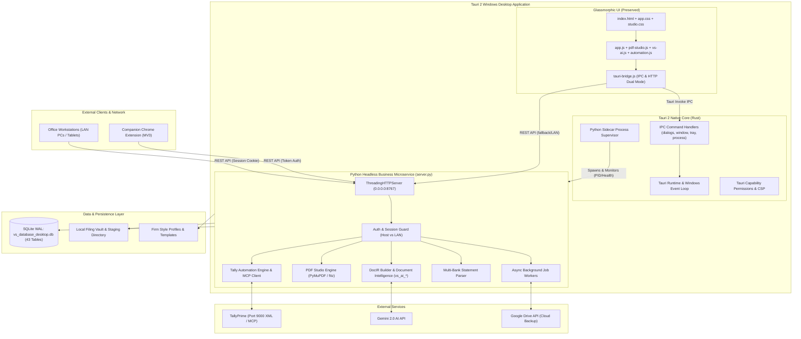

# VS Database 2.0 — Architecture Specification & Migration Blueprint
## Old vs. New Architecture Comparison

---

## 1. Executive Summary

This document specifies the architectural transition of the **VS Database** desktop application from its legacy architecture (Python + pywebview + localhost HTTP) to **Tauri 2 + Rust + WebView2**, while preserving 100% of the proven business logic, frontend styling, database records, and third-party integrations.

| Dimension | Legacy Architecture (v1.0) | Target Tauri 2 Architecture (v2.0) | Benefit / Rationale |
| :--- | :--- | :--- | :--- |
| **Desktop Shell** | Python 3 + `pywebview` (WinForms interop) | **Tauri 2 (Rust Core + WebView2)** | Native Windows binary, ~70% lower RAM footprint, eliminates WinForms CLR overhead |
| **Window Dragging** | Win32 `SendMessageW(WM_NCLBUTTONDOWN)` via `ctypes` | **HTML `data-tauri-drag-region` + Tauri Window API** | Hardware-accelerated, zero-flicker dragging without Win32 ctypes interop |
| **Single-Instance** | Win32 `kernel32.CreateMutexW` | **Tauri Single-Instance Plugin** | Reliable inter-process message routing and focus forwarding |
| **System Tray** | Handled in Python pywebview threads | **Tauri Native System Tray** | Native Windows Shell Notification Icon with instant response |
| **Autostart** | Python `winreg` registry manipulation | **Tauri Autostart Plugin** | Secure Windows startup registration via approved APIs |
| **Native Dialogs** | Python `pywebview.create_file_dialog` | **Tauri Dialog Plugin (`@tauri-apps/plugin-dialog`)** | Modern Windows IFileDialog with custom filters and folder pickers |
| **Backend Engine** | Python `ThreadingHTTPServer` (`server.py`) | **Retained Python Headless Microservice (Supervised Sidecar)** | Preserves 34,064 LOC of accounting, DocIR, PDF, and Tally logic with zero rewrite risk |
| **Desktop IPC** | HTTP REST over `127.0.0.1:8767` | **Tauri IPC (`invoke`) + Localhost Loopback** | High-speed binary IPC for desktop hooks; HTTP preserved for LAN & Chrome extension |
| **Database** | SQLite 3 (`vs_database_desktop.db`, WAL mode) | **SQLite 3 (`vs_database_desktop.db`, WAL + pooled readers)** | Preserves all 43 tables, 13,114 records, and integrity with zero schema migration risk |
| **Office LAN** | Direct binding to `0.0.0.0:8767` | **Preserved `0.0.0.0:8767` via Python Microservice** | Multi-PC office LAN sharing and client portal access remain completely operational |
| **Companion Extension**| Chrome MV3 extension connecting to `:8767` | **Preserved HTTP compatibility on `:8767`** | Chrome extension functions seamlessly with zero manifest changes |

---

## 2. Component Architecture Diagram

---

## 3. Preserved Subsystems (Zero Business Logic Loss)

1. **Accounting & Tally Prime Automation:**
   - [`tally_mcp_client.py`](file:///D:/AntiGravity%20Automation/VS%20Database%202.0%20-%20Tauri%20Migration/tally_mcp_client.py) and [`automation_engine.py`](file:///D:/AntiGravity%20Automation/VS%20Database%202.0%20-%20Tauri%20Migration/automation_engine.py) retain full XML envelope creation, voucher posting, and ledger reconciliation on port 9000.
2. **Document Intelligence & DocIR Engine:**
   - [`vs_ai_engine.py`](file:///D:/AntiGravity%20Automation/VS%20Database%202.0%20-%20Tauri%20Migration/vs_ai_engine.py) and [`vs_ai_doc_generator.py`](file:///D:/AntiGravity%20Automation/VS%20Database%202.0%20-%20Tauri%20Migration/vs_ai_doc_generator.py) retain multi-turn statutory drafting, clarification loops, style profile adherence, and deterministic Word/Excel/PDF rendering.
3. **PDF Studio Engine:**
   - [`pdf_studio_engine.py`](file:///D:/AntiGravity%20Automation/VS%20Database%202.0%20-%20Tauri%20Migration/pdf_studio_engine.py) retains PyMuPDF (`fitz`) rasterization, rotation, split, merge, compression, watermarking, and AES encryption.
4. **Statement Parser Engine:**
   - [`statement_parser.py`](file:///D:/AntiGravity%20Automation/VS%20Database%202.0%20-%20Tauri%20Migration/statement_parser.py) retains parsing rules for HDFC, ICICI, SBI, Axis, Kotak, and PNB banks.
5. **Database Storage:**
   - 43 SQLite tables remain in `data/vs_database_desktop.db` under WAL mode.
6. **Office LAN & Chrome Extension:**
   - `server.py` listens on `0.0.0.0:8767`, allowing companion browser extensions and network workstations to communicate uninterrupted.

---

## 4. Migrated Subsystems (Rust Native Implementations)

1. **Desktop Shell Launcher:**
   - Replaces `main_app.py` (which loaded `pywebview` and WinForms DLLs) with a compiled Tauri 2 binary (`vs_database.exe`).
2. **Process Lifecycle & Supervisor:**
   - Tauri Rust orchestrator launches `pythonw server.py --headless` on application launch, monitors `/api/desktop/health` until ready, and sends `/api/desktop/shutdown` followed by clean child process termination on window close.
3. **Window Controls & Frameless Dragging:**
   - Replaces Win32 ctypes `SendMessageW(WM_NCLBUTTONDOWN)` with HTML `data-tauri-drag-region` and Tauri window control commands (`appWindow.minimize()`, `appWindow.toggleMaximize()`, `appWindow.close()`).
4. **File System Dialogs:**
   - Replaces `pywebview.create_file_dialog` with Tauri Dialog Plugin (`open()`, `save()`).
5. **Single Instance & Deep Linking:**
   - Replaces custom Win32 Mutex with Tauri single-instance plugin to route secondary launches to the front window.
6. **System Tray & Autostart:**
   - Native Windows system tray with context menu (Open, Health, Exit) and native Windows startup registry management.

---

## 5. Security & Capability Matrix

Tauri 2 capabilities in `src-tauri/capabilities/default.json` are strictly scoped:
- **`dialog:default`**: Open and save file dialogs for PDF/Excel/Word workflows.
- **`opener:default`**: Open exported files in user's default registered Windows application.
- **`single-instance:default`**: Inter-process focus activation.
- **`autostart:default`**: Windows registry run key toggle.
- **`core:event:*`**: IPC event emitting and listening.
- **No Unrestricted Shell/FS Access:** Frontend JavaScript cannot run arbitrary shell commands or access arbitrary disk paths outside the designated application directories.

---

## 6. Migration Phasing & Verification Gates

- **Phase 5.1:** Scaffold Tauri 2 project structure (`src-tauri/`) and Cargo configuration.
- **Phase 5.2:** Adapt frontend asset references and establish `tauri-bridge.js` for dual IPC/HTTP support.
- **Phase 5.3:** Implement Rust process supervisor for the headless Python microservice.
- **Phase 5.4:** Implement Rust IPC commands (native dialogs, window state, system tray).
- **Phase 5.5:** Execute full QA regression suite comparing baseline to Tauri 2.
- **Phase 5.6:** Final security audit and performance benchmarking.
