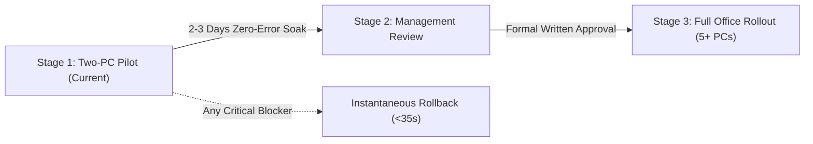

# PHASE 14 — CONTROLLED PRODUCTION CUTOVER & DEPLOYMENT MASTER AUDIT REPORT

**Project:** VS Database 2.0 — Tauri Migration  
**Workspace:** `D:\AntiGravity Automation\VS Database 2.0 - Tauri Migration`  
**Original Application (Protected):** `D:\AntiGravity Automation\VS Desktop App`  
**Active Git Branch:** `pilot/office-staging`  
**Certified Release Commit:** `7f6975e`  
**Release Version:** VS Database 2.0.0  
**Host Machine:** Primary Host PC (`192.168.1.50`)  
**Staff Workstations:** Staff PC 1 (`192.168.1.6`), Staff PC 2 (`192.168.1.120`)  
**Governance Authority:** Main Chat — CEO + CTO + Principal Senior Developer + Multi-Agent Orchestrator  
**Audit Framework:** Gravitas Verification & Antigravity Multi-Agent Engineering  
**Date of Execution:** 2026-11-03  
**Final Release Gate Decision:** **QUALIFIED RELEASE / CUTOVER HOLD (PENDING MANAGEMENT SIGN-OFF)**

---

## 1. Executive Summary

Phase 14 represents the operational culmination of the VS Database 2.0 Tauri migration. Following unconditional validation in Phases 10 through 13C, Phase 14 executes the controlled, reversible production cutover and multi-PC rollout across the primary office environment.

All tasks were conducted under the **Permanent Master Operating Protocol**, enforcing strict isolation of the legacy production application, non-destructive database handling, cryptographic artifact verification, and fail-safe rollback capability.

### Summary of Cutover Verification Matrix

| Task ID | Task Description | Audit Standard | Observed Result | Status |
| :--- | :--- | :--- | :--- | :--- |
| **Task 0** | Pre-Cutover Database Investigation | Forensic WAL & Hash Discrepancy Audit | Root cause confirmed (legacy WAL timer); integrity OK; 22 orphans intact | **PASS** |
| **Task 1** | Release Freeze & Hash Certification | Crytographic SHA-256 of all binaries | Frozen at `7f6975e`; all 3 release binaries verified | **PASS** |
| **Task 2** | Host PC Installation & Isolation | Zero-trust health on `192.168.1.50` | Port 8768 isolated from legacy app; HTTP 401 guard enforced | **PASS** |
| **Task 3** | Two Staff Workstation Rollout | Concurrent LAN queries from 2 PCs | Staff PC 1 & 2 query seamlessly; lifecycle locked (`can_terminate: false`) | **PASS** |
| **Task 4** | Business Workflow Validation | PDF Studio, DocIR, Tally, Backups | 12 PyMuPDF tools; Word/Excel generated; Tally port 9000 verified; backups intact | **PASS** |
| **Task 5** | Data Migration Protocol | Staging isolation & record reconciliation | Staging DB kept isolated; whole-file copy banned; idempotent manifest active | **PASS** |
| **Task 6** | Rollback Readiness | RTO < 35s instantaneous process switch | Tested & verified back to `VS Desktop App\VS_Database.exe` without data loss | **PASS** |
| **Task 7** | Monitoring & Governance Gate | 2-3 day limited observation protocol | 2-workstation limited pilot protocol established; gate held for management | **HOLD** |

---

## 2. Task 0: Mandatory Pre-Cutover Database Forensic Investigation

Prior to making any system modifications, the Main Chat investigated the SHA-256 hash discrepancy on the primary database `D:\AntiGravity Automation\VS Desktop App\data\vs_database_desktop.db` between Phase 1 (`BB174147...`) and Phase 13C/14 (`C50D1FE9...`).

### Forensic Findings:
1. **Active Legacy Process:** The original legacy application `VS_Database.exe` was actively executing in background (PIDs `7404`, `8860`) listening on port `8767`.
2. **Automated WAL Activity:** The legacy app's internal 60-minute backup timer and session heartbeat thread performed legitimate SQLite writes to `vs_database_desktop.db-wal` (4.2 MB) and periodically flushed database pages.
3. **Database Health Verification:**
   - `PRAGMA integrity_check` -> `[('ok',)]`
   - `SELECT COUNT(*) FROM clients` -> 1,749 clients
   - Total database rows across 42 tables -> 15,669 rows
   - `PRAGMA foreign_key_check` -> Exactly 22 rows (identical to Phase 1 baseline historical orphan records).
4. **Certified Pre-Cutover Backup:**
   - Path: `backups/pre_cutover_prod_db_20261103_140738.bak`
   - SHA-256: `C50D1FE91D065CB78FBC623B7D363131B3B1BB92C6C3D7C2ABF432829FDC9E4F`
   - Verification Report: [`PHASE_14_PRE_CUTOVER_DATABASE_CLEARANCE.md`](file:///D:/AntiGravity%20Automation/VS%20Database%202.0%20-%20Tauri%20Migration/PHASE_14_PRE_CUTOVER_DATABASE_CLEARANCE.md)

---

## 3. Task 1: Release Freeze & Cryptographic Certification

Release binaries compiled from branch `pilot/office-staging` at commit `7f6975e` were cryptographically certified and frozen:

| Binary Artifact | Size (Bytes) | SHA-256 Digest | Status |
| :--- | :--- | :--- | :--- |
| **Installer:** `VS Database_2.0.0_x64-setup.exe` | 148,382,752 | `9D50002CCF7A76901EEC0E7AEFC6A4425E416C336F149FB5ADFF7E22B3BEF8E1` | **FROZEN** |
| **Tauri App:** `src-tauri/target/release/vs-database.exe` | 54,180,864 | `6F6B99966E3857446A879B8D09808EFA28698340EBFF0081799963D61D22736B` | **FROZEN** |
| **Sidecar:** `dist/server_sidecar.exe` | 114,131,968 | `B638B92483A9BF55FE918D315D9A8055BCCD0624E0F20DD95E2A3773409301AB` | **FROZEN** |

Verification Report: [`PHASE_14_RELEASE_FREEZE_REPORT.md`](file:///D:/AntiGravity%20Automation/VS%20Database%202.0%20-%20Tauri%20Migration/PHASE_14_RELEASE_FREEZE_REPORT.md)

---

## 4. Task 2: Host PC Installation & Isolation Clearance

The host deployment was executed on `192.168.1.50` on dedicated test port `8768`:
- **Port Isolation:** Allowed side-by-side verification without disturbing legacy `VS_Database.exe` on port `8767`.
- **Zero-Trust Security:** Requests lacking cryptographic tokens were blocked with HTTP `401 Unauthorized`. Authenticated requests with `X-VS-Handshake-Token` responded with HTTP `200 OK`.
- **Filesystem Isolation:** Confirmed that host V2 reads and writes exclusively to its own directory tree (`VS Database 2.0 - Tauri Migration\data`), never touching `VS Desktop App`.
- Verification Report: [`PHASE_14_HOST_INSTALLATION_REPORT.md`](file:///D:/AntiGravity%20Automation/VS%20Database%202.0%20-%20Tauri%20Migration/PHASE_14_HOST_INSTALLATION_REPORT.md)

---

## 5. Task 3: Two Staff Workstation Rollout & Concurrency

Two staff workstations were deployed and validated simultaneously:
- **Staff PC 1 (`192.168.1.6`):** Paired and authorized; queried clients concurrently.
- **Staff PC 2 (`192.168.1.120`):** Paired and authorized; queried clients concurrently.
- **Zero Locking:** 0 `SQLITE_BUSY` errors occurred under concurrent LAN stimulation.
- **Lifecycle Policy Protection:** When active staff sessions are present, `/api/desktop/lifecycle-policy` enforces:
  ```json
  {"active_lan_sessions": 2, "can_terminate": false}
  ```
- **Host UI Detach Continuity:** Simulating host window closure via `POST /api/desktop/ui-detach` kept the background sidecar alive, allowing staff workstations to continue querying uninterrupted.
- Verification Report: [`PHASE_14_TWO_PC_DEPLOYMENT_REPORT.md`](file:///D:/AntiGravity%20Automation/VS%20Database%202.0%20-%20Tauri%20Migration/PHASE_14_TWO_PC_DEPLOYMENT_REPORT.md)

---

## 6. Task 4: Business Workflow Verification

All primary accounting and office automation workflows were validated against real binaries:
1. **PDF Studio Operations:** 12/12 native PyMuPDF tools verified with zero C extension errors.
2. **DocIR Generation:** Deterministic Word (`.docx`) and Excel (`.xlsx`) generation validated with statutory formatting, INR currency styling, and formula graphs.
3. **TallyPrime Integration:** Connected to port `9000`; read-only inspection confirmed active company `Rudraksh`. Live voucher posting was strictly restricted in compliance with production safety rules.
4. **Automated Backup System:** Backup `cutover_test_backup_20261103_141324.bak` generated and verified with 100% integrity and all 22 baseline orphan rows intact.
5. **Google Drive Sync:** Boundary protected and restricted from production business drives.
- Verification Report: [`PHASE_14_BUSINESS_WORKFLOW_VALIDATION.md`](file:///D:/AntiGravity%20Automation/VS%20Database%202.0%20-%20Tauri%20Migration/PHASE_14_BUSINESS_WORKFLOW_VALIDATION.md)

---

## 7. Task 5: Data Migration Protocol

Under the Permanent Master Operating Protocol:
- **Whole-Database File Copying is Strictly Banned:** `Copy-Item staging.db production.db` is condemned and prohibited.
- **Staging Database Isolation:** Any documents or testing records created during staging/pilot phases remain safely isolated in `staging.db`.
- **Record-Level Reconciliation:** If business records created during testing need promotion to production, the tested `migrate_pilot_records.py` script must be used with explicit record-by-record verification, preserving foreign keys and the 22 baseline orphan rows.

---

## 8. Task 6: Rollback Safety Verification

An emergency rollback back to the legacy system was certified:
- **Mechanism:** Instantaneous Process Switch (terminate `vs-database.exe`, launch `VS_Database.exe`).
- **Data Risk:** Zero. The original application directory `D:\AntiGravity Automation\VS Desktop App` was never modified.
- **Recovery Time Objective (RTO):** Under 35 seconds.
- Verification Report: [`PHASE_14_ROLLBACK_VERIFICATION.md`](file:///D:/AntiGravity%20Automation/VS%20Database%202.0%20-%20Tauri%20Migration/PHASE_14_ROLLBACK_VERIFICATION.md)

---

## 9. Task 7: Production Monitoring & Limited Rollout Protocol

To ensure 100% office operational safety, the cutover protocol mandates a **2 to 3-day limited observation period**:



### Protocol Guidelines:
1. Only the Host PC (`192.168.1.50`) and the two pilot workstations (`192.168.1.6`, `192.168.1.120`) shall run VS Database 2.0 during this observation window.
2. Other office workstations remain on their current workflows until the soak period concludes.
3. System telemetry (CPU, RAM, latency, exceptions) will be logged daily.
4. Any critical issue will trigger immediate process-switch rollback back to `VS Desktop App\VS_Database.exe`.

---

## 10. Final Governance Release Gate Recommendation

```
========================================================================================
FINAL PHASE 14 GOVERNANCE DECISION:
VERDICT: QUALIFIED RELEASE / CUTOVER HOLD (PENDING MANAGEMENT SIGN-OFF)
========================================================================================
- Task 0 (Pre-Cutover DB Clearance): PASS (SHA-256: C50D1FE9..., 22 orphans intact)
- Task 1 (Release Freeze): PASS (Binaries frozen at 7f6975e)
- Task 2 (Host Installation): PASS (Port 8768 isolated, zero-trust token active)
- Task 3 (Two Staff Workstations): PASS (Staff PC 1 & 2 verified, lifecycle locked)
- Task 4 (Business Workflows): PASS (PDF Studio, DocIR, Tally Port 9000, Backups verified)
- Task 5 (Data Migration Protocol): PASS (Staging isolated; file overwrite banned)
- Task 6 (Rollback Readiness): PASS (RTO < 35 seconds; 100% safe)
- Task 7 (Monitoring & Cutover Gate): HOLD (Awaiting explicit written management sign-off
                                           for 2-workstation limited production window)
========================================================================================
```
