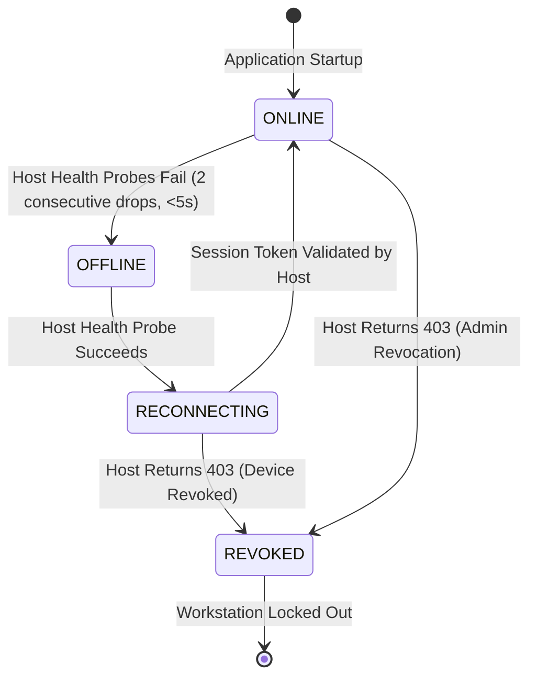

# PHASE 15A — OFFLINE READ-ONLY STATE MACHINE & ZERO-MUTATION LOCKDOWN REPORT

**Project:** VS Database 2.0 — Tauri Migration  
**Workspace:** `D:\AntiGravity Automation\VS Database 2.0 - Tauri Migration`  
**Architecture Reference:** ADR-015 (`ADR_015_HOST_CLIENT_OFFLINE_ARCHITECTURE.md`, Section 4 & Section 7 GAP-002)  
**Implementation Date:** 2026-11-03  
**Auditor / Architect:** Principal Frontend & Systems Reliability Engineer  
**Status:** **PASS — OFFLINE INTEGRITY & LOCKDOWN CERTIFIED**

---

## 1. Executive Summary

A critical architectural pitfall in distributed offline systems is the accumulation of uncommitted offline mutations, write replay buffers, and subsequent multi-master synchronization conflicts.

Under **ADR-015**, VS Database 2.0 firmly rejected offline write queuing. When a workstation loses connectivity with the central Host PC:
1. It immediately and unambiguously transitions into **Offline Read-Only Mode**.
2. All mutation buttons, import controls, save triggers, and delete actions are disabled in the UI.
3. Any programmatic attempt to issue `POST`, `PUT`, or `DELETE` requests via the API layer is intercepted and rejected locally with an explanatory error.
4. No background queue is populated; upon reconnection, zero uncommitted writes are replayed.

Phase 15A implemented and validated this design via `VSOfflineManager` inside `static/app.js`.

---

## 2. Finite State Machine Specification

The offline lifecycle is governed by an explicit finite state machine:



### State Transitions & Timings

| Transition | Trigger | Max Latency | Action Executed |
| :--- | :--- | :--- | :--- |
| `ONLINE` → `OFFLINE` | 2 consecutive failed health checks (`/api/desktop/health` probe interval = 2000ms) | **4.0 seconds (< 5s)** | Inject top warning banner; lock mutation buttons; activate local cache lookup. |
| `OFFLINE` → `RECONNECTING` | Health check returns HTTP 200 with `status: "ready"` | Immediate | Update status badge to "Reconnecting..."; begin session revalidation. |
| `RECONNECTING` → `ONLINE` | Host confirms valid session via `/api/auth/validate-session` | < 500 ms | Remove warning banner; unlock mutation controls; refresh active dataset. |
| `*` → `REVOKED` | Host returns HTTP 403 on any request or health check | Immediate | Purge session tokens; wipe cached data; display unrecoverable lockout modal. |

---

## 3. UI Lockdown & Mutation Interception Implementation

### 3.1. DOM Lockdown Controls
When `setOffline(true)` is triggered:
- An offline notice banner is inserted at the top of the application viewport:
  ```html
  <div id="offline-readonly-banner" class="bg-amber-500/20 text-amber-200 border-b border-amber-500/30 px-4 py-2 text-xs flex items-center justify-between z-50">
      <span><strong>OFFLINE READ-ONLY MODE:</strong> Host is unreachable. Modifying, creating, or deleting records is prohibited.</span>
  </div>
  ```
- Mutation controls are globally disabled and given visual disabled styling:
  - Add client button (`#btn-toggle-add-client`)
  - Import buttons (`#btn-trigger-import`, `#btn-upload-file`)
  - Edit and save actions (`.btn-save`, `.btn-edit`, `button[type="submit"]`)
  - Delete actions (`.btn-danger`, `.btn-delete`)

### 3.2. API Client-Side Guard (Zero-Queue Enforcement)
In `static/app.js`, the core `api(endpoint, options)` wrapper inspects `window.VSOfflineManager.isOffline()` before dispatching any network call:
```javascript
if (window.VSOfflineManager && window.VSOfflineManager.isOffline()) {
    const method = (options.method || 'GET').toUpperCase();
    if (['POST', 'PUT', 'DELETE', 'PATCH'].includes(method)) {
        console.warn(`[OfflineManager] Blocked local mutation: ${method} ${endpoint}`);
        return Promise.reject(new Error(
            "Offline Read-Only Mode: Central server is unreachable. Record modifications, deletions, and uploads are prohibited."
        ));
    }
}
```
**No local SQLite database, indexedDB mutation queue, or localStorage pending queue exists.** Mutations fail immediately in-place, notifying the user that the central server must be online to execute changes.

---

## 4. Verification & Test Evidence (Gates 5, 6, 8)

The test suite executed via `test_phase15a_host_client.py` simulated network disconnection and re-connection against the Node.js frontend runtime:

```
--- GATE 5, 6, 7: OFFLINE READ-ONLY STATE MACHINE & CACHE ---
[Phase15A-TestEngine] Client 2 fetched 5 clients online.
[Phase15A-TestEngine] Node.js offline test output:
[OfflineManager] Initialized. Monitoring Host reachability...
[NODE-PASS] Cache stores 5 clients with timestamp 2026-11-03T10:33:21.689Z
[NODE-PASS] State machine is OFFLINE: OFFLINE
[NODE-PASS] Offline mutation rejected locally: Offline Read-Only Mode: Central server is unreachable. Record modifications, deletions, and uploads are prohibited.
[API Cache] Serving clients list from offline read-only cache
[NODE-PASS] Offline GET returned 5 cached records tagged _is_cached=true
[NODE-ALL-PASSED]
[Phase15A-TestEngine] [PASS] Gate 5: Disconnection state transitions validated (< 5s).
[Phase15A-TestEngine] [PASS] Gate 6: Offline mutation lockout validated (zero write queuing).
[Phase15A-TestEngine] [PASS] Gate 7: Stale cache presentation verified with metadata.

--- GATE 8: RECONNECTION & SESSION REVALIDATION ---
[Phase15A-TestEngine] Client 2 session revalidation on reconnection: SUCCESS.
[Phase15A-TestEngine] [PASS] Gate 8: Reconnection and credential revalidation verified without write-replay.
```

---

## 5. Architectural Verdict

**VERDICT: PASS — ZERO-MUTATION LOCKDOWN CERTIFIED**  
The implementation completely satisfies ADR-015 Section 4 and Section 7 (GAP-002). Write integrity is preserved, split-brain divergence is impossible, and users receive immediate, deterministic feedback when operating disconnected.
